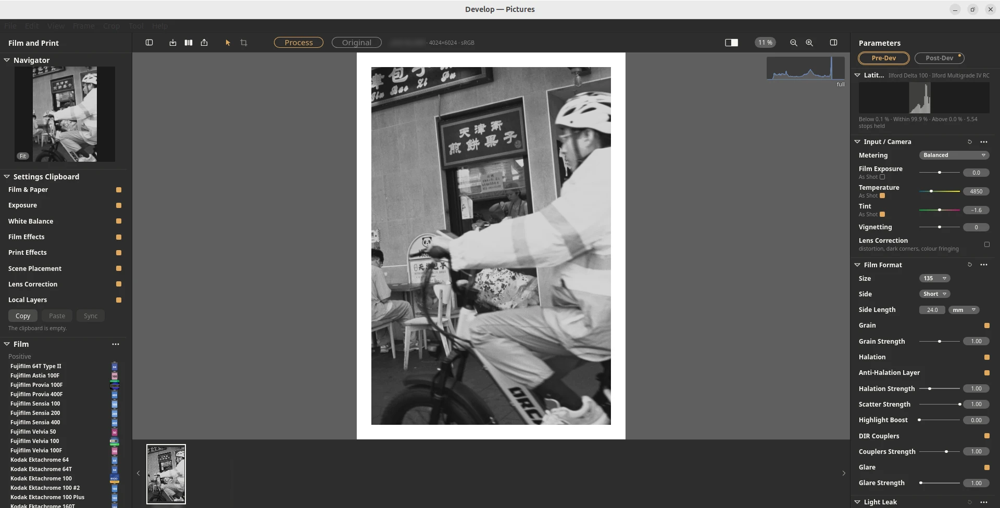

# Develop

[English](README.md) · [简体中文](README.zh-CN.md) · [日本語](README.ja.md) · [한국어](README.ko.md) · [Español](README.es.md) · **Deutsch** · [Français](README.fr.md) · [Português (Brasil)](README.pt-BR.md)

> *„Ich fotografiere spiegellos und auf Film, und ich kann ehrlich sagen: Die Ergebnisse von Develop sehen aus wie
> echter Film. Es malt keinen Film-Look mit Kurven und LUTs über ein Foto, sondern belichtet die Farbstoffschichten
> des Films mit dem Licht der Szene, entwickelt sie und vergrößert das Negativ auf Papier, wie in der Dunkelkammer.
> Heraus kommt keine Nachahmung von Film, sondern das, was dieser Film aus demselben Licht gemacht hätte.“*
> **jegly**, Fotograf und Autor von Develop

Eine Dunkelkammer zur Filmemulation für Linux. Öffne ein RAW oder ein JPEG, wähle einen Film und ein Papier und erhalte
einen physikalisch modellierten Abzug: Das Licht wird durch die Farbstoffschichten von Film und Papier verfolgt, mit Korn,
Halation, DIR-Kupplern und dem Filterpaket des Vergrößerers, gerendert auf deiner GPU über Vulkan.

**Develop ist ein inoffizieller Linux-Fork von [SpektraLab](https://github.com/JamesQiu2005/SpektraLab)**,
dessen Engine von [spektrafilm](https://github.com/andreavolpato/spektrafilm) von Andrea Volpato abgeleitet ist. Es ist
mit keinem der beiden Projekte verbunden und wird von keinem unterstützt. Das Filmmodell, die gemessenen Profile und das
Abzugs- und Scanmodell stammen von ihnen; Develop ist die Linux-Portierung und die darauf aufbauende App.

**Mit Mac, iPhone oder iPad unterwegs? Nimm [SpektraLab](https://github.com/JamesQiu2005/SpektraLab).** Develop ist für
Linux und Android; SpektraLab ist die ursprüngliche App, gemacht für Apples Geräte.



## Was es kann

- **130 Filme und Papiere**: Farbnegativ-, Dia-, Kino- und Schwarzweißfilme, vergrößert auf Farb- oder
  Multigrade-Papier oder gescannt. Nach Marke sortiert.
- **Die ganze Engine auf Vulkan**: Jeder Effekt der Mac-App wird unter Linux gerendert, auch Filmrand und Datumsrückwand,
  Objektivfehler und Weichzeichnerfilter, Lichtlecks, das Digital Intermediate, lokale Szenenebenen und der HDR-Diascan.
- **Der Editor zeigt, was exportiert wird**: Das Bild auf dem Bildschirm ist die Datei, die du bekommst.
- Halbformat-Paare, Doppelbelichtungen, HSL, Kanalmixer, Dynamik, Wasserzeichen, Lichtlecks, Objektivcharaktere und der
  Filmrand, wie in SpektraLabs Mac-App.
- Export als JPEG, PNG und 16-Bit-TIFF in sRGB, Display P3, Adobe RGB oder ProPhoto.

## Wie sich Develop von SpektraLab unterscheidet

SpektraLab ist eine Mac-App auf Metal. Das Repository enthält auch Windows-Viewer und eine Engine, die sich unter Linux
bauen lässt, aber unter Linux und Windows verweigerte diese Engine viele Effekte des Mac. Develop ist ein vollständiger
Linux-Editor auf Basis dieser Engine.

**Was Develop hinzufügt**

| | Develop | SpektraLab |
|---|---|---|
| Linux-Desktop-Editor | ja, mit `.deb` und Snap | nur Engine und Host |
| Engine-Effekte auf Vulkan (Linux, Windows) | alle: Filmrand und Datumsrückwand, Digital Intermediate, Szenenumfang, Kontrastmaske, Objektivfehler und Weichzeichnerfilter, Lichtlecks, Szenenebenen, HDR-Diascan | die meisten verweigert |
| Farbe auf Vulkan | behoben: seit 2.4.0 ein Rotstich in jedem Vulkan-Render (ein Weichzeichnungsmodus, der den Vulkan-Kernels fehlte) | Rotstich |
| Filme und Papiere | 130, darunter 93 neue Filmprofile aus den veröffentlichten Datenblättern der Hersteller | 38 |
| Netzwerk | keins: durch einen seccomp-Filter blockiert, keine Update-Prüfung | prüft auf Updates |
| Objektivkorrektur | die Datenbank von lensfun, dazu „Meine Objektive“ für manuelle Objektive, die sie nicht kennt | nur auf dem Mac |
| Lokale Ebenen | Verlaufs-, Radial- und Vollbildmasken für Belichtung und Wärme, auf den Szenenebenen der Engine | (Engine-Funktion) |
| Layouts mit mehreren Fotos | Diptychen, Triptychen, Raster und Kinostandbilder, mit Abständen und Rändern | nein |
| Ränder | ein Abzugsrand in beliebigem Grau | nein |
| Erweitertes Panel | Entwicklungskontrast, Weichheit von Objektiv und Scanner, Lichterreserve, Weiß- und Schwarzpunkt des Scanners | nicht zugänglich |

**Was SpektraLab hat und Develop nicht**

- Die Fotobibliothek, das Lesen von Capture-One-Katalogen und den Light Table.
- HDR: ein Bild auf einem HDR-Bildschirm anzeigen und HDR-Dateien (Gain Map) exportieren. Der HDR-Diascan der Engine ist
  portiert, aber die Web-Ansicht unter Linux kann kein HDR anzeigen.
- Nach Updates suchen. Absichtlich weggelassen: Develop hat keinen Netzwerkzugriff.
- Die App für iPhone und iPad sowie Builds für Mac und Windows.

## Wie die neuen Filme entstanden sind

SpektraLab liefert die 28 gemessenen Profile von spektrafilm und einige eigene. Develop fügt 93 Filmprofile hinzu, die
meisten für längst eingestellte Filme, rekonstruiert aus den Datenblättern, die ihre Hersteller veröffentlicht haben:
Fujifilms *Professional Data Guide* (2005), Kodaks technische Publikationen zu den VISION-Kinonegativen, den Diafilmen
EKTACHROME, ELITE Chrome und KODACHROME und seinen Fotonegativen sowie die Schwarzweiß-Datenblätter von Ilford/HARMAN und
Fujifilm.

1. **Die Kurven aus den Datenblättern lesen.** Für jeden Film: seine spektrale Empfindlichkeit (wie jede Schicht auf jede
   Wellenlänge reagiert), seine Schwärzungskurven (Dichte über Belichtung) und seine spektralen Farbstoffdichten (die
   Farbe, die jeder Farbstoff absorbiert). Die meisten Datenblätter sind PDFs, die ihre Diagramme als Vektorpfade
   speichern, daher lesen die Digitalisierer in `engine/tools/fujifilm_data_guide/` die Kurven direkt aus diesen Pfaden.
   Jede Achse wird an die eigenen Gitterlinien und Beschriftungen des Diagramms angepasst, sodass nur der Zeichenfehler
   des Herausgebers übrig bleibt. Diagramme, die nur als Bild vorliegen, werden mit 600 dpi nachgezeichnet.
2. **Daraus Profile machen.** Die Kurven durchlaufen spektrafilms eigene Profilfabrik und danach dieselben Regeln wie
   spektrafilms ausgelieferte Profile. Jede Anpassung, die von der Engine abhängt (das Filterpaket des Papiers, die
   Graurampe, das Korn), wird mit der Engine selbst gerechnet. Wo ein Datenblatt etwas auslässt (manche VISION-Datenblätter
   haben keine Neutral- oder D-min-Kurve), wird es aus den eigenen Daten des Films abgeleitet, und das `metadata` des
   Profils vermerkt das.
3. **Die Methode an vergleichbaren Filmen prüfen.** Dieselbe Kette lief über spektrafilms eigene Rohdaten für Filme, die
   es schon hat. Pro 400H, Velvia 100, Vision3 500T, Kodachrome 64 und Ektachrome 100 liegen innerhalb von ΔE2000 1,0 bis
   2,1 (Mittelwert, auf einem ColorChecker) von spektrafilms gemessenen Profilen. Der Digitalisierer reproduziert außerdem
   spektrafilms rohe Kodachrome-64-Kurven aus Kodaks Datenblatt auf 0,009 genau.

Jedes Profil verzeichnet in seinem `metadata` die Quellpublikation und seine Anpassungsfehler, und
`engine/resources_product/NOTICE.md` listet sie alle auf. Es sind Rekonstruktionen aus veröffentlichten Daten, keine
Messungen an echtem Film. Sie kommen jedem Film so nahe, wie es das Datenblatt seines Herstellers zulässt.

## Kein Netzwerk, aus Prinzip

Develop kann das Internet nicht erreichen. Ein seccomp-Filter, der installiert wird, bevor irgendetwas anderes startet,
erlaubt nur lokale Sockets, und die App startet nicht, wenn der Filter nicht gesetzt werden kann. Er gilt für das Fenster,
seine Web-Ansicht und die Engine. Es gibt keine Update-Prüfung, keine Telemetrie, keine entfernten Schriften und keine
Konten. Deine Fotos verlassen nie deinen Rechner.

## Branches

| Branch | Was es ist |
|---|---|
| `main` | Develop für Linux und die Engine, auf der jede App aufbaut |
| `camera` | Develop Camera: eine Filmkamera für Android, in `camera/` |
| `android` | Der Editor von Develop auf Android (in Arbeit) |

Jeder App-Branch beginnt bei `main`, sodass Engine-Korrekturen alle erreichen.

## Develop Camera (Android)

Eine Filmkamera für Android 17, die durch Develops Filmmodelle fotografiert. Wähle einen der 121 Filme von Develop und sieh
ihn live im Sucher. Jede Aufnahme entwickelt danach dieselbe Engine auf der GPU des Telefons: der Film, sein Papier, Korn,
Halation und der Rest, wie in der Desktop-App.

- Entwickelt aus den RAW-Daten des Sensors, mit den kameraeigenen Korrekturen für jedes Bild.
- Korn, Halation, Weichzeichnerfilter, Objektivcharaktere, Schwarzweißfilter, Push und Pull, Lichtlecks, Filmrand und
  Datumsrückwand.
- 35 mm, Halbformat-Paare, XPan, Triptychen und Mehrfachbelichtungen sowie 120 von 6×4,5 bis 6×17.
- Automatik mit Belichtungsspeicher oder manuelle Verschlusszeit und ISO.
- Fragt nur nach der Kameraberechtigung und hat keinen Netzwerkzugriff. Fotos landen in `DCIM/Develop Camera`.

Getestet auf einem Pixel 11 Pro Fold. Seine GPU übersprang drei der Objektiv-Kernels der Engine, wodurch jeder Render mit
Weichzeichner schwarz wurde; diese Kernels sind auf `main` behoben. Die Bauanleitung steht in `camera/BUILD.md`.

## Der Editor von Develop auf Android

Eine Portierung des Linux-Editors auf Android, im Branch `android`. Sie behält das Desktop-Layout bei, mit Anpassungen für
Touch. Sie ist noch nicht einsatzbereit.

## Installation

Lade das `.deb` oder den Snap aus dem [neuesten Release](https://github.com/jegly/Develop/releases/latest) herunter und installiere eins davon:

```sh
sudo apt install ./Develop_1.0.0_amd64.deb
sudo snap install --dangerous ./develop_1.0.0_amd64.snap
```

Der Snap braucht `--dangerous`, weil er aus einer Datei installiert wird und nicht aus dem Snap Store. Oder baue es aus dem Quellcode (siehe unten).

Develop braucht eine GPU mit Vulkan-Treiber. Entwickelt wurde es unter Ubuntu 26.04 mit Intel-Grafik (Mesa). Das `.deb`
zieht `libvulkan1`, `liblensfun1`, `liblensfun-data-v1`, `fonts-urw-base35`, `fonts-liberation-sans-narrow` und
`fonts-dejavu-core` nach. Der Snap bringt eigene Kopien mit.

## Bauen

```sh
engine/build-linux.sh                 # the engine and its host, staged in build/host-linux-x64
cd desktop && npm ci
npx tauri build --no-bundle           # the app: desktop/src-tauri/target/release/develop
SPEKTRALAB_BUNDLES=deb node scripts/package.mjs linux    # .deb in desktop/release/linux
sh scripts/build-snap.sh              # snap from that .deb, in desktop/release/snap
```

Zum Bauen braucht es einen C++20-Compiler, CMake, Ninja, die Vulkan-Header und `glslangValidator`, Node 22 mit npm, Rust
(stable), die WebKitGTK-4.1-Entwicklungspakete, die Tauri verlangt, und `liblensfun-dev` für die Objektivkorrektur (es baut
auch ohne, dann fehlt diese Funktion).

## Testen

```sh
(cd build/linux && ctest)             # the Vulkan kernels against float64 references
python3 engine/tests/host_smoke.py --host build/host-linux-x64/spektralab-host \
    --resources build/host-linux-x64/engine
(cd desktop && npm run check)         # typecheck, lint, unit tests
(cd desktop/src-tauri && cargo test)  # includes the no-network test
```

Die eigenen Engine-Prüfungen des Originalprojekts (`engine/tests/*_checks.py`) laufen ebenfalls gegen die Linux-Engine.

## Danksagung und Lizenz

**Develop basiert auf SpektraLab, dessen Engine von spektrafilm von Andrea Volpato abgeleitet ist (GPL-3.0-or-later).**
Die 28 gemessenen Film- und Papierprofile von spektrafilm und die Abzugs-LUTs werden unverändert verwendet. Die übrigen
Profile sind aus den veröffentlichten Datenblättern der Hersteller entstanden (`engine/resources_product/NOTICE.md`). Film-
und Papiernamen sind Marken ihrer Inhaber; sie geben an, aus welchen veröffentlichten Daten ein Profil erstellt wurde.

| | |
|---|---|
| die App und die Engine | GPL-3.0-or-later (`license/LICENSE`) |
| spektrafilms Film- und Papierprofile, die Abzugs-LUTs | CC BY-SA 4.0 (`license/SPEKTRAFILM_LICENSE.txt`) |
| lensfun (gelinkt, und seine Objektivdatenbank) | LGPL-3.0 / CC BY-SA 3.0 |
| stb_truetype | gemeinfrei / MIT |

SpektraLab™ und sein Symbol gehören ihren Inhabern. Develop verwendet einen eigenen Namen und ein eigenes Symbol, wie es
die Lizenzbedingungen von SpektraLab von veröffentlichten Forks verlangen.
