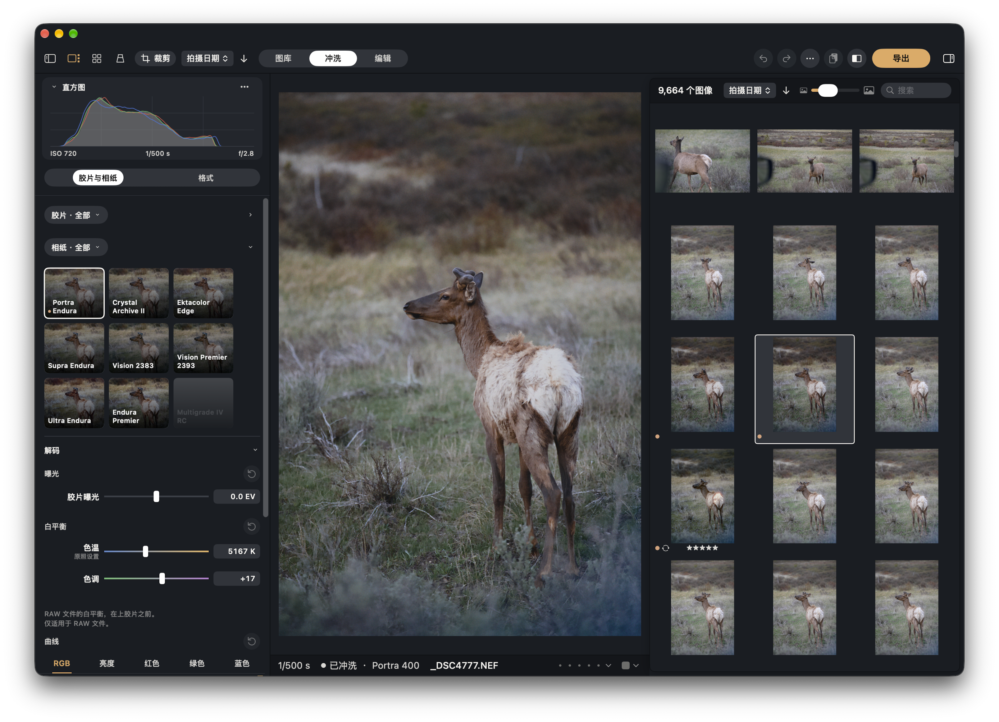
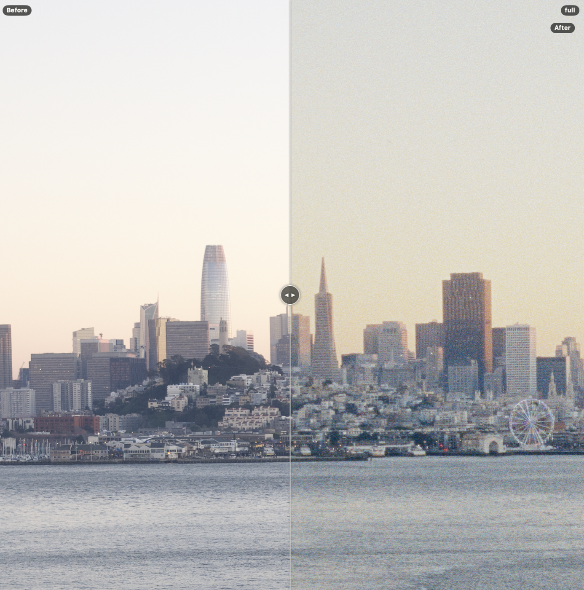
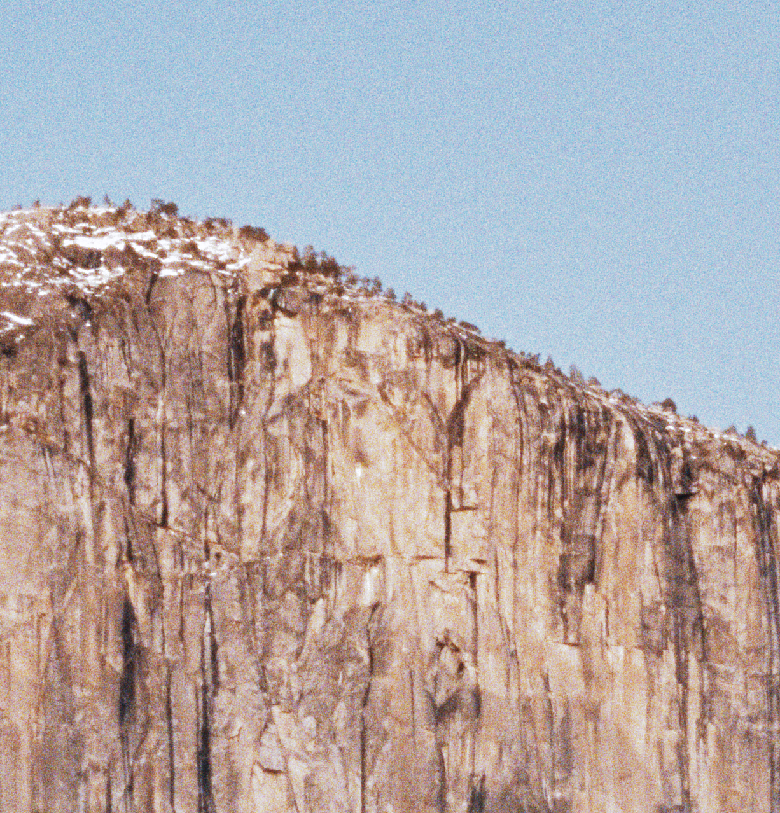

# SpektraLab

**English** · [简体中文](README.zh-CN.md) · [spektralab.app](https://spektralab.app)

A film-emulation darkroom for the Mac. Open a RAW, pick a film and a paper, and get a physically
modelled print: light traced through the film's dye layers and the paper's, with grain, halation,
DIR couplers and the enlarger's filter pack, at full resolution in about a second.

**The SpektraLab engine is a C++/Metal implementation derived from
[spektrafilm](https://github.com/andreavolpato/spektrafilm) by Andrea Volpato (GPL-3.0-or-later).**
The film simulation, its 28 measured film and paper profiles and the print and scan model are
spektrafilm's; SpektraLab is the engine's implementation on Metal and the Mac app built around it.



## What it does

- **Spectral, not a LUT.** Light is traced through 81 wavelengths, the film's dye layers and the
  paper's, the way a darkroom does it. Colour negative, slide, cine negative and print film, colour
  and black-and-white papers.
- **Physical units.** Tell it the negative is 135 or 120 and grain, halation and coupler diffusion
  scale with the frame in micrometres.
- **Develop and Edit.** Develop is the darkroom: the film and the paper; the decode (film
  exposure, white balance, and a curve on the scene before it reaches the film); the format; and
  the effects (grain, halation, scatter, glare, couplers). Edit works on the finished print:
  brightness, contrast, tone, curves, HSL, channels, colour wheels, vibrance, saturation,
  temperature and vignette.
- **The film itself.** Film Edge prints the frame on its own strip (rebate, perforations, each
  stock's edge print and frame numbers) in 135, half frame, XPan, 645 to 6×9, 6×12 and 6×17. Date
  Back exposes a date onto the negative.
- **Half-frame pairs.** Two frames on one frame's worth of 135, each with its own exposure, white
  balance and print.
- **A library.** SpektraLab catalogs and sessions, with albums, variants, ratings and colour tags;
  an import page fed by Finder or by pictures dragged onto the window; settings copied from one
  picture and pasted onto many.
- **Capture One catalogs and sessions, read-only.** SpektraLab reads a Capture One catalog through a
  snapshot copy and a session as its folders, and never writes to either: no rating, no edit, no
  file goes back. Edits stay SpektraLab's. There is no Lightroom catalog support.
- **The Light Table.** Developed frames lie on a light pad at their true size, measured in
  millimetres, to be moved and turned.
- **Export.** JPEG, HEIF and PNG at 8 bits, TIFF at 16, in sRGB, Adobe RGB, Display P3 or ProPhoto
  RGB, with saved recipes. A batch develops each picture again from its original, one at a time.
- **English, 简体中文, 繁體中文 and 日本語.**

| RAW decode ⟷ film and paper | grain at 1:1 |
|---|---|
|  |  |

## Build

macOS 15 or later on Apple silicon, and **Xcode 27 or later** with its Metal toolchain. Xcode 26
cannot type-check parts of the app. Since Xcode 26 the Metal compiler is a separate component:
`xcodebuild -downloadComponent MetalToolchain`. The app is a Mac Catalyst app.

```bash
app/SpektraLab/tools/build_engine_mac.sh      # the SpektraLab engine for Mac Catalyst, its kernels and resources
cd app/SpektraLab
python3 gen_project.py                        # writes SpektraLab.xcodeproj from the source tree
xcodebuild -project SpektraLab.xcodeproj -scheme SpektraLab -configuration Debug \
    -destination 'platform=macOS,variant=Mac Catalyst' \
    -derivedDataPath build/DerivedData build
open build/DerivedData/Build/Products/Debug-maccatalyst/SpektraLab.app
```

- `build_engine_mac.sh` compiles `engine/` (C++20, `-O2`, the Metal kernels with safe math for
  macOS 15) into `build/engine-macosx/libspektralab_engine.a` and lays the baked constants, the
  profiles and `spektralab.metallib` into `build/engine-macosx/EngineResources/`, which the app
  copies into its bundle. Run it again after any change under `engine/`.
- `gen_project.py` generates the project from the files on disk: run it again after adding or
  removing a source file. Nothing else needs Python, and nothing needs Python at run time.
- If Xcode suddenly cannot find `metal`, clean the build folder (⇧⌘K): the Metal toolchain's path
  changed under a cached build.

The library helper `spklib-host` is in this repository as a prebuilt, checksummed binary
(`vendor/spklib/macos/`), and the build copies it into the app. To build it from source too, see
[`API-SPEC-library-helper.md`](API-SPEC-library-helper.md) §7.

## Test

```bash
cd app/SpektraLab
tools/selftest.sh                   # the model and page self-tests, compiled with swiftc
python3 tools/localization_check.py # every sentence in four languages
```

The engine's parity harnesses (`engine/tests/parity_*.py`) compare it with spektrafilm's Python
reference and need a checkout of spektrafilm on `PYTHONPATH`;
[`docs/agents/BUILD-AND-TEST.md`](docs/agents/BUILD-AND-TEST.md) says how.

## Layout

| | |
|---|---|
| `app/SpektraLab/` | the Mac app: SwiftUI, UIKit and Metal under Mac Catalyst |
| `engine/` | the SpektraLab engine: C++20, its Metal kernels and its C ABI (`spk_*`) |
| `engine/resources/` | baked constants, spektrafilm's 28 film and paper profiles, print LUTs |
| `engine/resources_product/` | SpektraLab's own black-and-white films and paper, and CineStill 800T |
| `vendor/spklib/` | the library helper, prebuilt from spklib |
| `ARCHITECTURE.md` | how the engine fits together |
| `AGENTS.md` | conventions and the traps that cost real time |

## Windows and Linux

This repository also contains a C++/Vulkan backend for the engine, native LibRaw decoding, RGB16
TIFF export and Windows desktop viewers, contributed separately from the Mac app. See the
[Windows build guide](engine/WINDOWS.md) and [feature coverage](engine/WINDOWS_FEATURE_COVERAGE.md)
for the tested scope. The [Qt Quick frontend](windows_UI/README.md) brings the film/print editor
layout to Windows; the [minimal Win32 viewer](engine/WINDOWS_DESKTOP.md) is also retained. The Mac
app described above has interface and display features they do not.

## Support SpektraLab

SpektraLab for the Mac is free and open source, and it will stay that way. If it has earned a place
in your work and you'd like to support where it goes next, please consider SpektraLab for iPhone and
iPad on the App Store. Code **25OFF** takes 25% off.

## Credits and licence

**The SpektraLab engine is a C++/Metal implementation derived from spektrafilm by Andrea Volpato
(GPL-3.0-or-later).** The film process model, its 28 measured colour profiles and the print LUTs
are [spektrafilm](https://github.com/andreavolpato/spektrafilm)'s. The four black-and-white film
profiles and the Multigrade paper profile are SpektraLab's own, built from the manufacturers'
published data sheets (`engine/resources_product/NOTICE.md`). `license/NOTICE.md` says what was
derived and what was changed.

| | |
|---|---|
| the app and the engine | GPL-3.0-or-later (`license/LICENSE`) |
| spektrafilm's film and paper profiles, the print LUTs | CC BY-SA 4.0 (`license/SPEKTRAFILM_LICENSE.txt`) |
| metal-cpp | Apache-2.0 |
| spklib, the library helper | MIT, shipped as a prebuilt helper binary |

<!-- The spklib link below resolves only once that repository is published. -->
Capture One catalogs are read by spklib (MIT, https://github.com/JamesQiu2005/SpektraLab_library);
the app ships its prebuilt helper.

## Trademark

SpektraLab™ and the SpektraLab icon are managed by Guangzhou Songzi Intelligent
Technology Services Co., Ltd.; trademark registration is in progress.

Forks are welcome. You can study, modify, port and redistribute the code under
its licences, which cover the code and data but not the name or the icon. Keeping
both in a personal fork is fine. If you publish a build for other people, even a
free one, please give it its own name and icon. You are welcome to say it is
based on SpektraLab, as long as it is clear that your project is unofficial.

We reserve the right to act against builds that pass themselves off as official
or imply our endorsement.

Capture One is a trademark of Capture One A/S. SpektraLab and spklib are not affiliated with or
endorsed by it; they read a catalog and never write to it. SpektraLab is not affiliated with or
endorsed by the spektrafilm project. Film and paper names are their owners' trademarks; they say
which published data a profile was built from.
