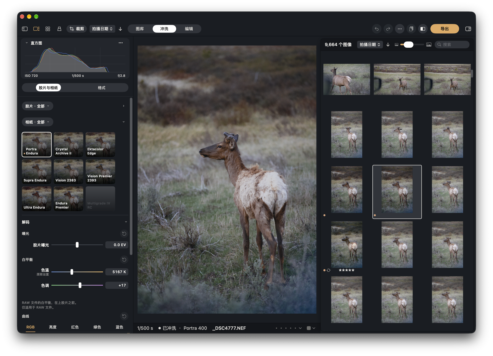
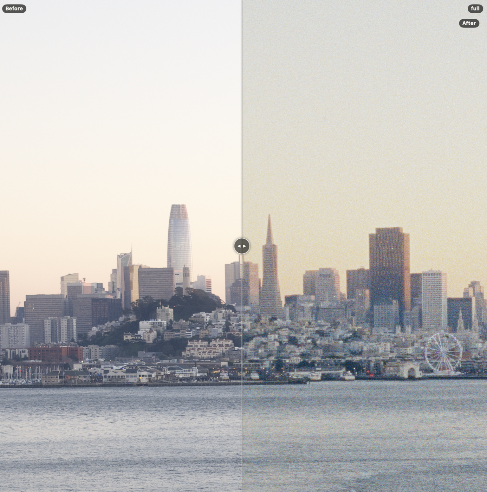
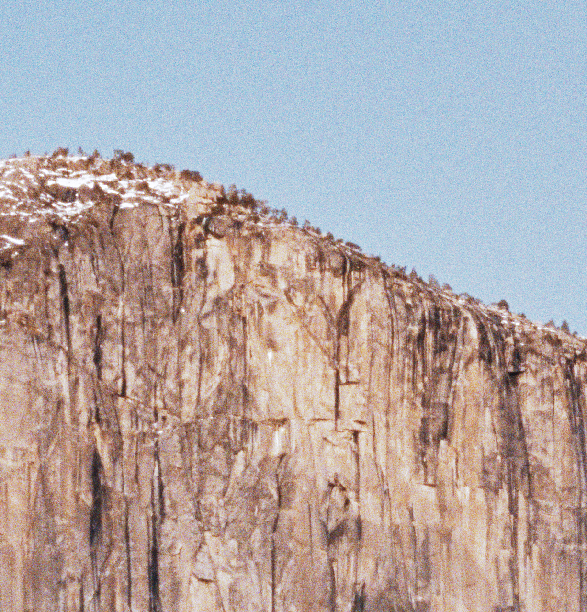

# SpektraLab

[English](README.md) · **简体中文** · [spektralab.app](https://spektralab.app)

Mac 上的胶片暗房。打开一张 RAW，选好胶片和相纸，得到一张按物理过程建模的照片：光线穿过胶片与相纸各自的染料层，颗粒、光晕、DIR 成色剂、放大机滤色一样不少，全分辨率渲染约一秒。

**SpektraLab 引擎是基于 Andrea Volpato 的 [spektrafilm](https://github.com/andreavolpato/spektrafilm)（GPL-3.0-or-later）派生而来的 C++/Metal 实现。**（The SpektraLab engine is a C++/Metal implementation derived from spektrafilm by Andrea Volpato (GPL-3.0-or-later).）胶片模拟、28 款实测胶片与相纸配置、印放与扫描模型都来自 spektrafilm；SpektraLab 是这套引擎在 Metal 上的实现，以及围绕它构建的 Mac 应用。



## 功能

- **光谱计算，不是 LUT。** 光线以 81 个波长穿过胶片与相纸各自的染料层，和暗房里的过程一致。彩色负片、反转片、电影负片与拷贝片，彩色与黑白相纸。
- **物理尺度。** 告诉它底片是 135 还是 120，颗粒、光晕和成色剂扩散就按画幅以微米为单位缩放。
- **冲洗与编辑。** 冲洗是暗房：胶片与相纸；解码（胶片曝光、白平衡，以及作用于进入胶片之前的场景的曲线）；画幅；效果（颗粒、光晕、散射、眩光、成色剂）。编辑作用于冲印好的照片：亮度、对比度、影调、曲线、HSL、通道、色轮、自然饱和度、饱和度、色温与暗角。
- **胶片本身。** 片边把画面印在它自己的胶片上（片基、齿孔、各胶片自己的片边字与格号），支持 135、半格、XPan、645 至 6×9、6×12 与 6×17。日期后背把日期曝在底片上。
- **半格拼接。** 两张照片同在一格 135 的胶片上，各自有独立的曝光、白平衡与印放。
- **图库。** SpektraLab 目录与会话，支持相册、变体、评级与色标；导入页可从访达选择，也可直接把照片拖进窗口；一张照片的设置可以复制并粘贴到多张照片上。
- **只读 Capture One 目录与会话。** SpektraLab 通过快照副本读取 Capture One 目录，把会话当作文件夹读取，从不写回：评级、编辑、文件都不会回到 Capture One。编辑始终保存在 SpektraLab 自己这边。不支持 Lightroom 目录。
- **看片台。** 冲好的底片按真实尺寸（以毫米计）摆在灯箱上，可以移动和旋转。
- **导出。** JPEG、HEIF、PNG（8 位）与 TIFF（16 位），色彩空间可选 sRGB、Adobe RGB、Display P3 或 ProPhoto RGB，并可保存导出配方。批量导出逐张进行，每张都从原片重新冲洗。
- **English、简体中文、繁體中文与日本語。**

| RAW 解码 ⟷ 胶片与相纸 | 1:1 颗粒 |
|---|---|
|  |  |

## 构建

需要 Apple 芯片、macOS 15 或更高版本，以及带 Metal 工具链的 **Xcode 27 或更高版本**（Xcode 26 无法完成部分代码的类型检查；从 Xcode 26 起 Metal 编译器是单独的组件：`xcodebuild -downloadComponent MetalToolchain`）。应用是一个 Mac Catalyst 应用。

```bash
app/SpektraLab/tools/build_engine_mac.sh      # 为 Mac Catalyst 构建 SpektraLab 引擎、着色器与资源
cd app/SpektraLab
python3 gen_project.py                        # 按源码目录生成 SpektraLab.xcodeproj
xcodebuild -project SpektraLab.xcodeproj -scheme SpektraLab -configuration Debug \
    -destination 'platform=macOS,variant=Mac Catalyst' \
    -derivedDataPath build/DerivedData build
open build/DerivedData/Build/Products/Debug-maccatalyst/SpektraLab.app
```

- `build_engine_mac.sh` 把 `engine/`（C++20，`-O2`，着色器以安全数学模式按 macOS 15 编译）编译为 `build/engine-macosx/libspektralab_engine.a`，并把预烘焙常量、配置文件与 `spektralab.metallib` 放进 `build/engine-macosx/EngineResources/`，由应用复制进包内。`engine/` 下有任何改动后请重新运行。
- `gen_project.py` 按磁盘上的文件生成工程：增删源文件后请重新运行。除此之外构建不需要 Python，运行时也不需要。
- 若 Xcode 突然找不到 `metal`，清理构建文件夹（⇧⌘K）即可：Metal 工具链的路径变了，而旧构建缓存了原路径。

图库助手 `spklib-host` 以预编译、带校验和的二进制形式放在本仓库（`vendor/spklib/macos/`），构建时会复制进应用。若也要从源码构建它，见 [`API-SPEC-library-helper.md`](API-SPEC-library-helper.md) §7。

## 测试

```bash
cd app/SpektraLab
tools/selftest.sh                   # 模型与页面的自检，用 swiftc 编译
python3 tools/localization_check.py # 四种语言的全部文案
```

引擎的一致性检验（`engine/tests/parity_*.py`）把它与 spektrafilm 的 Python 参考实现逐项比对，需要在 `PYTHONPATH` 上提供一份 spektrafilm 检出；方法见 [`docs/agents/BUILD-AND-TEST.md`](docs/agents/BUILD-AND-TEST.md)。

## 目录

| | |
|---|---|
| `app/SpektraLab/` | Mac 应用：Mac Catalyst 下的 SwiftUI、UIKit 与 Metal |
| `engine/` | SpektraLab 引擎：C++20、Metal 着色器与 C ABI（`spk_*`） |
| `engine/resources/` | 预烘焙常量、spektrafilm 的 28 款胶片与相纸配置、放大 LUT |
| `engine/resources_product/` | SpektraLab 自己的黑白胶片与相纸配置，以及 CineStill 800T |
| `vendor/spklib/` | 图库助手，由 spklib 预编译 |
| `ARCHITECTURE.md` | 引擎的整体结构 |
| `AGENTS.md` | 约定，以及真正耗过时间的坑 |

## Windows 与 Linux

本仓库还包含独立于 Mac 应用贡献的 C++/Vulkan 引擎后端、原生 LibRaw 解码、RGB16 TIFF 导出和 Windows 桌面界面。构建方法见 [Windows 说明](engine/WINDOWS.md)，已验证功能及限制见 [功能覆盖表](engine/WINDOWS_FEATURE_COVERAGE.md)。[Qt Quick 前端](windows_UI/README.md) 把胶片与相纸编辑布局带到 Windows，同时保留[最小 Win32 窗口](engine/WINDOWS_DESKTOP.md)。上文介绍的 Mac 应用还有它们尚未具备的界面与显示功能。

## 支持 SpektraLab

SpektraLab Mac 版免费、开源，并将一直如此。如果它在你的创作中有了一席之地，而你愿意支持它接下来的发展，欢迎考虑 App Store 上的 SpektraLab iPhone 与 iPad 版。优惠码 **25OFF** 可享 75 折。

## 致谢与许可

**SpektraLab 引擎是基于 Andrea Volpato 的 spektrafilm（GPL-3.0-or-later）派生而来的 C++/Metal 实现。** 胶片过程模型、28 款实测彩色配置与放大 LUT 来自 [spektrafilm](https://github.com/andreavolpato/spektrafilm)。4 款黑白胶片配置与 Multigrade 相纸配置是 SpektraLab 自己的，依据厂商公开的技术资料构建（`engine/resources_product/NOTICE.md`）。哪些是派生、改动了什么，见 `license/NOTICE.md`。

| | |
|---|---|
| 应用与引擎 | GPL-3.0-or-later（`license/LICENSE`） |
| spektrafilm 的胶片与相纸配置、放大 LUT | CC BY-SA 4.0（`license/SPEKTRAFILM_LICENSE.txt`） |
| metal-cpp | Apache-2.0 |
| 图库助手 spklib | MIT，以预编译助手二进制随应用附带 |

<!-- 下方 spklib 链接要等该仓库公开后才能打开。 The spklib link resolves only once that repository is published. -->
Capture One 目录由 spklib 读取（MIT，https://github.com/JamesQiu2005/SpektraLab_library），应用附带其预编译助手。

Capture One 是 Capture One A/S 的商标。SpektraLab 与 spklib 与其无关联，也未获其认可；它们只读取目录，从不写入。（Capture One is a trademark of Capture One A/S. SpektraLab and spklib are not affiliated with or endorsed by it; they read a catalog and never write to it.）SpektraLab 与 spektrafilm 项目无关联，也未获其认可。胶片与相纸名称是各自所有者的商标，仅用于说明配置依据的是哪份公开资料。
