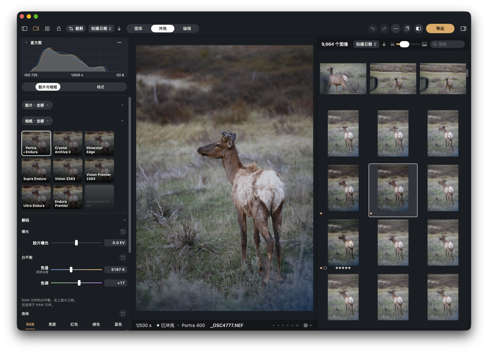

# SpektraLab 2.2.1 user guide

**English** · [简体中文](USER-GUIDE.zh-CN.md)



This guide is for the Mac app, version 2.2.1. It says what each part does and where to find it. Names in **bold** are the app's own labels, spelled as the app spells them.

## Contents

1. [What SpektraLab is](#1-what-spektralab-is)
2. [Install and requirements](#2-install-and-requirements)
3. [The window](#3-the-window)
4. [Library](#4-library)
5. [Import](#5-import)
6. [Develop](#6-develop)
7. [Crop, straighten, perspective](#7-crop-straighten-perspective)
8. [Edit](#8-edit)
9. [Half-frame pairs](#9-half-frame-pairs)
10. [Export](#10-export)
11. [Light Table](#11-light-table)
12. [Settings](#12-settings)
13. [Agents: the command line and MCP](#13-agents-the-command-line-and-mcp)
14. [Keyboard shortcuts](#14-keyboard-shortcuts)
15. [Updates, versions and where your data lives](#15-updates-versions-and-where-your-data-lives)
16. [Troubleshooting and FAQ](#16-troubleshooting-and-faq)

---

## 1. What SpektraLab is

SpektraLab is a film darkroom for the Mac. You open a photograph, choose a film and a paper, and SpektraLab works out the print the way a darkroom would: light goes through the film's dye layers, the film is developed, and light goes through the film onto the paper. Grain, halation (the glow around bright points) and the other effects are part of that process, and they scale with the size of the film frame. The result is made at full resolution.

It is a simulation of a physical process, not a set of filters. The engine behind it is a C++/Metal implementation derived from [spektrafilm](https://github.com/andreavolpato/spektrafilm) by Andrea Volpato (GPL-3.0-or-later).

**What it is not.** SpektraLab does not retouch. There are no masks and no brushes. After the print, **Edit** gives you Light, Curve and Colour adjustments on the finished picture, and that is all. If you want to dodge, burn or clone, do it in other software.

**What it does:**

- Colour negative, slide, cine negative and print film, and colour and black-and-white papers.
- A library of SpektraLab catalogs and sessions, with ratings and colour labels.
- Capture One catalogs and sessions, read-only. SpektraLab never writes to them.
- Film Edge (the rebate, perforations, edge print and frame numbers), Date Back, and half-frame pairs.
- A Light Table where developed frames lie at their true size.
- Export to JPEG, HEIF, PNG and TIFF.
- A command line and an MCP server, so other programs can drive it.
- English, 简体中文, 繁體中文 and 日本語.

**Licence.** The app and the engine are GPL-3.0-or-later. The colour film and paper profiles are spektrafilm's (CC BY-SA 4.0). The black-and-white films and their paper are SpektraLab's own profiles, built from the makers' published data sheets, also CC BY-SA 4.0. **Settings › General › Licences and credits** has the full notices.

---

## 2. Install and requirements

- **macOS 15 or later**, on **Apple silicon**.
- The download is a single disk image (DMG), signed and notarised. Open it and drag SpektraLab into your Applications folder.
- The DMG is universal, which means it also contains code for Intel Macs. **Intel Macs are untested.** It may work, and it may not. Apple silicon is the supported machine.
- Xcode 27 only matters if you build SpektraLab from source. Using the app does not need it.
- Nothing needs Python, at install time or at run time.

SpektraLab is free and open source.

---

## 3. The window

SpektraLab has one main window. It is laid out like this:

- **A left column.** At its top is a row of three modes: **Library**, **Develop** and **Edit**. Under the row is what belongs to the mode: in Library, the sidebar; in Develop and Edit, the histogram and the controls.
- **The picture** in the middle.
- **A browser** at the right: a grid of the pictures in the current collection. It is shared by all three modes, so you can click another picture while you are developing.
- **An info strip** under the picture, in every mode. It shows the exposure, the file name, the rating and colour label, and (in Develop and Edit) what the develop is doing: for example "Developed", then the film and paper. When you choose several pictures it says how many.
- **A bar** along the top. At its left are the controls that all modes share: **Sidebar** (hide or show the left column), **Viewer** (the picture beside the grid, on or off), **Grid** (the grid takes the whole window), **Light Table**, **Crop** and **Sort**. In the middle is the mode row, once the window is wide enough. At the right, in Develop and Edit, are Undo, Redo, the "···" menu, Paste Settings, Compare and Export.

Four things are full-window pages, not modes: the **Light Table**, **Import**, **Export** and **Settings**. Each has its own way back.

Some useful habits:

- Click a picture in the browser to choose it. In Develop or Edit, that opens it on the canvas.
- Drag the line between the left column and the picture to change the column's width. The width is kept.
- **Settings › Appearance** sets Light, Dark or System mode, the background colour and the interface scale (80, 100, 120 or 150 %).

---

## 4. Library

The Library is where your pictures are listed. It is modelled on Capture One's Library tool, so if you know that, most of it will be familiar.

### 4.1 Sources

A **source** is somewhere pictures live. The source picker at the top of the Library sidebar lists them:

| Source | What it is |
|---|---|
| **SpektraLab catalog** (`.spkcatalog`) | A catalog SpektraLab keeps for you. You choose where the file lives, and you can have several. By default, importing into a catalog leaves your files where they are (it references them). |
| **SpektraLab session** (a folder with `Capture`, `Selects`, `Output` and `Trash` folders, plus a `.spksession` file) | A working folder for one shoot. By default, importing into a session copies the files into its `Capture` folder. |
| **Capture One catalog** (`.cocatalog`) | Read one way. See 4.3. |
| **Capture One session** (a folder with a `.cosessiondb`) | Its picture files are listed as a folder. SpektraLab does not read the session's database. |
| **A linked folder** | Any Finder folder. SpektraLab lists the pictures in it and keeps the list in step with the folder. |

**To make a catalog:** use the **+** menu below the sidebar, or the source picker, and choose **New Catalog…**. Give it a name and a place. If the name is taken at that place, SpektraLab asks you to pick another. **To open one:** choose **Open Catalog or Folder…** in the same menu. It accepts a `.spkcatalog`, a SpektraLab session folder, a `.cocatalog`, a Capture One session folder, or any other folder (which becomes a linked folder).

The first time you start with no catalog, the Library says **No catalog yet** and offers **New Catalog…**.

**Linked folders and kept folders are kept in step.** When you select such a source, and when you come back to the app (at most once a minute), SpektraLab looks at the folder:

- A new file is added.
- A file that moved keeps its row, so it keeps its rating, label and edit.
- A file that went missing is hidden, and comes back if the file does.
- A folder on a disk that is not connected is marked as not connected, and nothing in it changes.

SpektraLab never moves, renames or deletes the files in your folders. Choose **Read Again** in the **+** menu to read a source again by hand. **Remove from List** takes a source off the list and deletes nothing on disk.

### 4.2 The sidebar

The sidebar has three tabs: **Library**, **Filters** and **Info**.

**Library tab.** An outline of the source's collections, each with a count:

- **Catalog Collections**: **All Images**, **Recent Imports** (each import under its own time), **Recent Captures**, **In Catalog** and **Trash**.
- **User Collections**: projects, groups and albums. SpektraLab's own sources have **Favourites** here.
- **Folders**: the folder tree, each folder under its disk.

A collection's menu has **Open in Develop**. Capture One's own collection names are shown as Capture One names them.

**Filters tab.** Tick values to narrow the grid. The facets are **Rating**, **Colour Label**, **Date** (year, then month), **Camera**, **Lens**, **File Type** and **Keywords** (when there are any). SpektraLab adds one of its own: **Opened in Develop**. Each value shows a count, worked out with your other ticks applied. **Clear Filters** removes them all. The **Filter** field at the bottom of the sidebar narrows the rows of the tab you are looking at.

**Info tab.** The chosen picture's details: when it was taken, camera and lens, exposure, size, film, whether it is developed, and where the original is.

At the top of the sidebar are **Import** and **Export** buttons.

### 4.3 Capture One catalogs and sessions

SpektraLab can show a Capture One catalog or session in the Library. This is strictly one way.

- **A catalog** is read through a snapshot. SpektraLab copies the catalog's database file to a temporary place, checks the copy, and reads only the copy. Your `.cocatalog` is never opened for writing.
- **Nothing goes back to Capture One.** No rating, label, album, Trash flag or file is ever written to Capture One's files.
- **Ratings and colour labels** you set in SpektraLab are SpektraLab's own. They are kept in a mirror that SpektraLab holds for the catalog, and Capture One's original rating stays beside them. Edits you make in Develop and Edit stay in SpektraLab too.
- **While Capture One is writing** to its catalog, SpektraLab cannot read it. The source then shows **Capture One is writing to it: read again in a moment**. Wait, then use **Read Again**.
- **A smart album** is listed but greyed: SpektraLab does not evaluate Capture One's smart albums. Capture One's own albums cannot be renamed or added to from SpektraLab.
- **You can import into a Capture One source.** The files become SpektraLab's rows in the mirror, under their own **Recent Imports** entry, and they stay there when the catalog is read again.
- **To work on a copy**, use **Copy to SpektraLab Catalog…** (in the **+** menu, the source picker, or **Settings › Sources**). It makes a new `.spkcatalog` and opens it. The Capture One source stays on the list. Later, **Update from Capture One** brings in changes. If you changed something on both sides, SpektraLab's side wins.
- A Capture One picture becomes a SpektraLab frame the first time you open it in Develop. Browsing a catalog of ten thousand pictures develops nothing.

There is no Lightroom support.

### 4.4 The grid

The grid shows the pictures of the current collection. Its header has a **Sort** menu (**Date Taken**, **Name**, **Rating**, **Date Imported**, **Date Added**), an ascending/descending button, the count, a thumbnail size slider and a **Search** field (file names).

Each cell can show badges under the picture: the rating, the colour label and the film.

| Do this | To get this |
|---|---|
| Click | Choose one picture |
| ⌘-click / ⇧-click | Add or remove one / choose a run |
| Double-click, or Return | Open in Develop |
| Arrow keys | Move the choice (with ⇧, extend it) |
| ⌘A, ⇧⌘A, ⌘I | Select all, select none, invert |
| ⌘+ / ⌘− | Larger / smaller thumbnails |
| Delete | Remove SpektraLab's edit and preview of the chosen pictures it has opened (it asks first, and says what goes with them) |

**The cell's menu** (secondary click) has: **Open in Develop**, **Put on Light Table**, **Make Half-Frame Pair**, **Info**, **Export**, **Copy Settings**, **Paste Settings**, **Develop Preview** (or **Develop Previews**), **Favourite** or **Unfavourite**, and **Remove from SpektraLab**. On several chosen pictures, Export, Paste, Favourite and Remove apply to all of them.

A picture that has never been developed shows the preview inside the file until you open it in Develop or export it. A picture whose edit has changed since its preview was made is marked **Preview out of date**. Use **Develop Preview** to make it again.

### 4.5 Ratings and colour labels

- **Rating:** press **0** to **5** with pictures chosen. This works in every mode. You can also click the stars in the info strip.
- **Colour label:** **Red**, **Orange**, **Yellow**, **Green**, **Blue**, **Pink** or **Purple**, or none. The keys **−**, **\*** and **+** set red, yellow and green. The info strip also has a label picker.

Ratings and labels work on SpektraLab catalogs and sessions, linked folders, and Capture One sources (where they are SpektraLab's own, see 4.3).

### 4.6 Trash

**Remove from SpektraLab** does not delete a file. It moves the picture into its source's **Trash** collection (in the sidebar's **Catalog Collections**). If SpektraLab has edited the picture, it asks first, because the picture's edit and preview go with it.

Inside the **Trash** collection, the cell's menu changes:

- **Put Back** takes the picture out of the Trash, as it was.
- **Move to Trash** sends the files to the **system Trash**, after asking. Finder can still put them back. This is the only way SpektraLab ever removes a file from disk, and it is only offered in the Trash collection.

Capture One sources have no SpektraLab Trash, and nothing is ever removed from a Capture One catalog.

---

## 5. Import

Open the Import page with the **Import** button in the sidebar, **+ › Import…**, **File › Import** or **⇧⌘I**. You can also drag pictures, folders or catalogs onto the window; the page says **Drop to Import** while you hold them over it. SpektraLab then opens the page with what you dropped.

The page is modelled on Capture One's Import Images window. On the left are the settings; on the right is a grid of what was found.

- **Import From.** Choose a folder or pictures (**Choose…**). **Include Subfolders** is on by default.
- **What is imported.** RAW, JPEG, HEIF, TIFF, PNG and DNG files. Sidecars and movies are left out.
- **Import To.** A SpektraLab catalog or session. The default is the one selected in the Library, else the last one you opened, else **New Catalog…**, which makes a "SpektraLab Catalog" in your Pictures folder when the import starts.
- **Placement.** For a catalog: **Add to Catalog** (your files stay where they are), **Copy to Folder…** (SpektraLab copies the files to a folder you choose and adds the copies; the originals are only read, and nothing is overwritten), or **Copy into the Catalog** (into the catalog's own `Originals` folder, sorted by date). For a session: **Add to Session**, **Copy into the Session's Capture Folder** (the default), or **Copy to Folder…**. Pictures dropped from another app must be copied.
- **Exclude Duplicates.** A file that the destination already holds (same path, or same name and size) is greyed and not imported.
- **Collection.** Each import becomes one entry under **Recent Imports**.
- **Filters.** Narrow what is shown by **Format** and **Date Taken**.
- **Choosing.** The grid works like the Library's: click, ⌘-click, ⇧-click, drag a box. The button reads **Import All (n)** with nothing chosen, and **Import n Selected** when you have chosen some. Esc cancels.

Importing does not develop anything. A picture is developed when you open it in Develop, paste settings onto it, or export it.

---

## 6. Develop

Choose **Develop** in the mode row. The column has two tabs, **Film & Paper** and **Format**, under the histogram. A few controls (the "···" menu, Undo, Compare, Export) are in the top bar.

SpektraLab does not render live. A number follows your pointer as you drag, and a picture is made when the drag rests or ends. Settings that only affect the print are re-printed quickly from the same negative. Settings that affect the film are developed again when you let go. The info strip says what it is doing.

### 6.1 Film & Paper

Two strips of cards, with **Decode** under them.

**The Film strip and the Paper strip.** Each card shows your picture through that film, or on that paper. Click a card to choose it. Each strip has a pill with a menu, **Film · All** and **Paper · All**, that narrows the strip to a shelf. The film shelves are **All**, **Negative**, **Positive**, **Cine** and **B&W**. The paper shelves are **All**, **Standard** and **B&W**. A chevron at the right of each strip folds it away, and the fold is remembered. A wheel or trackpad scrolls a strip sideways.

The rules for pairing are physical, and the cards show them:

- **A negative film is printed on a paper.** When you choose a film, it brings its own paper. On the Paper strip, that paper wears a small dot in the film's colour. The dot means "the film's own paper". You can choose another.
- **A slide (Positive) film is scanned, never printed.** There is no paper for it, and every paper card is greyed. The page says "A slide is the picture itself: it is scanned, not printed."
- **Silver on silver, colour on colour.** A black-and-white film prints only on the black-and-white paper, and a colour film only on a colour paper. A paper that cannot print the chosen film is greyed, and cannot be chosen.

While a develop is running the card shows a spinner. If a card could not be made, it shows a retry mark; use **Retry** from its menu.

**Apply Film Emulation.** A switch under Decode. Turned off, the film and paper are greyed and the picture is Apple's own decode of the file, with Edit still on top. Film Exposure, the Decode curve, Film Edge, Date Back and the effects stand down, because there is no film. White balance still works. A half-frame pair has no such switch.

**The Digital Intermediate card.** The last card of the Paper strip, under a colour negative, is **Digital Intermediate**. It is not a paper. Choosing it scans the negative in place of printing it: you get a flat, neutral scan of the negative, with no paper's contrast, the kind of file a lab sends before grading. The paper you had chosen is kept underneath. To go back, choose any paper card, and that paper prints again. The card is not offered under a slide or under a black-and-white film.

**Decode.** What is done to the scene before it reaches the film. Its title line folds it, and it has three parts, each with its own reset (↺):

- **Exposure**: **Film Exposure**, from −8 to +8 EV. It changes how much light the negative gets. It is not a brightness control: the enlarger re-times the print, so the print's mid-grey does not simply follow it. If you want the picture brighter or darker, use Edit's **Brightness**.
- **White Balance**: **Temperature** (2000–10000 K) and **Tint**. These work on RAW files only. A JPEG or TIFF already had its white balance set by the camera. The camera's own balance is **As Shot**.
- **Curve**: a curve on the scene before the film, in stops around the metered mid-grey (±8). It replaces the old Scene Placement. A picture that had a Scene Placement before keeps it, so it does not change, and Develop's reset removes it.

The ↺ of Film & Paper puts back the whole of Decode.

**Metering.** SpektraLab meters each picture itself, and Film Exposure is added to that. This is why pasting settings does not paste a number that was solved for another picture: each picture meters its own exposure.

**Lens correction** (distortion and vignetting from the RAW's lens profile) is a setting for all RAW pictures at once, in **Settings › Develop › Lens Correction**.

**The enlarger.** The 2.2.1 Mac app has no enlarger controls. A picture that was edited earlier with print brightness, filter shifts or pre-flash still prints with those values, so it does not change. **Reset** in the "···" menu (titled Develop on this tab) puts them back to zero.

### 6.2 Format

The second tab, **Format**, is the film's frame and what is exposed onto it.

**The film's size.** Cards for **110**, **APS**, **135** and **120**. The size tells SpektraLab how large your frame is on the film, in millimetres, and grain, halation and coupler diffusion scale with it. A large format makes finer grain. When Film Edge is on, the size is the Film Edge's format instead and the cards stand down.

**Film Edge.** A switch with a fold. Turned on, the frame is printed on its own film: the rebate, the perforations, the stock's edge print and frame numbers, as a scan of the strip would show them. Under it:

- **Adjust Framing** opens the crop page. With Film Edge on, the crop box is the film's gate, and you move and enlarge the picture under it.
- **Format**: 135, Half, 645, 6×6, 6×7, 6×8, 6×9, XPan, 6×12 or 6×17. A format that the chosen film was never made in is shown but cannot be chosen, and the page says why.
- **View**: **Strip** (the film's full width) or **Filed** (a sliver of film around the frame).
- The edge tools: **Gate** (the shape of the frame's corners, which a camera body decides), **Holes** (**None**, **White** or **Black**; 120 has none), **Edge fog**, **Spool leaks**, and **Brightness** of the edge print. **Body** says which camera the film was shot through. **Another** gives it a different body. **Frame no.** and **Advance** set the frame number.
- **Turn the film a quarter** (↻) turns the film.

**Date Back.** A switch with a fold. It exposes a date onto the negative, the way a camera's date back does. You choose a face (**LCD**, **Dots**, or **Data**, which prints the shutter and aperture between frames and needs Film Edge), the **Corner**, the **Size** and the **Brightness**. A face that the chosen format never printed cannot be chosen.

**Remove anti-halation layer.** A switch the page labels *Experimental simulation for all stocks*. It takes the film's anti-halation layer out of the simulation.

**Effects.** Five rulers, in this order:

| Effect | What it does |
|---|---|
| **Grain** | Strength of grain. 1.00× is the film's own. |
| **Halation** | The glow around bright points, from light that passes through the film and comes back. 1.00× is the film's own. |
| **Scatter** | How far light spreads inside the emulsion. 0 is none. |
| **Glare** | The paper's veil: light spread across the print. Greyed when nothing is printed (a scan has none). |
| **Couplers** | How strongly the film's layers hold each other back (DIR couplers). 1.00× is the film's own. |

The ↺ of Format puts back the format, the effects and the couplers. It does not touch Film Edge or Date Back, which have their own switches.

**Remember:** a film or paper profile is a measurement. SpektraLab does not offer controls that bend the material. The sliders move what a darkroom can move.

### 6.3 Copy, paste and presets

**Copy Settings** takes the settings of one picture so you can paste them onto others.

- **⌘C** copies the open picture's settings (in the Library, the chosen picture's) with the groups you last ticked. **⇧⌘C** opens the **Copy Settings** sheet first, so you can choose the groups.
- The groups are **Film & Paper**, **Film Exposure**, **Format**, **Film Edge & Date Back** (not ticked at first), **Enlarger**, **Decode**, **Couplers**, **Pre-flash**, **Light**, **Curve** and **Colour**. Under each name the sheet shows what the group holds for this picture.
- **⌘V** (or the paste button, **Paste Settings**) pastes onto the open picture, or onto every chosen picture in the Library. Pasting writes settings, not solved numbers: each picture meters its own exposure and keeps its own white balance under As Shot. A crop, the framing and the picture's film-edge seed never travel. If a pasted film or paper does not exist in this build, SpektraLab says **Unavailable materials**.
- After a paste in the Library, the pictures' previews are developed again (the sidebar says "Developing N pictures", with a **Stop** button).
- The paste button is greyed with **Nothing is copied yet** until you copy.

**Presets** (in the "···" menu) keep a look under a name. **Save Preset** saves chosen groups of the open picture. Click a preset to apply it. Each has **Rename** and **Delete**, and **Undo Delete** brings back the last one deleted.

### 6.4 Compare, the original, undo and redo

- **Compare** (the button in the top bar, or **Y**) splits the picture: the original as decoded on one side, the developed picture on the other. Drag the divider. Secondary-click the button to show **Original** or **Process** (the developed picture) on its own.
- Hold **Space** to see the original while the key is down.
- **Undo** and **Redo** (⌘Z, ⇧⌘Z) walk back through your edits. One slider drag is one step.
- **Reset** (⌘R, or in the "···" menu) puts back what the current tab holds. It asks first.

### 6.5 The "···" menu

The round "···" button in the top bar (labelled **Edit actions**) has: **Undo**, **Redo**, **Reset**, **Copy Settings**, **Presets** and **Settings** (which opens the Settings page).

### 6.6 Canvas Colour Space

The canvas shows the picture in Display P3, the widest space a Mac display shows. **Canvas Colour Space** lets you judge it as a file in another space would hold it. The choices are **ProPhoto RGB**, **Display P3**, **Adobe RGB** and **sRGB**.

- **ProPhoto RGB** and **Display P3** show the picture as made. On a Display P3 screen they look the same. The choice says which space you are judging for.
- **Adobe RGB** and **sRGB** *proof* the picture: they put it through SpektraLab's own gamut compression into that space and show what an exported file in that space holds. Strong colours may look less saturated. Nothing about the edit changes.

This is only the canvas. It never changes the edit or the export. The Export page has its own proof, which follows the recipe (section 10).

### 6.7 Zoom

Scroll or pinch to zoom. **,** fits the picture to the window, **.** shows it at actual size (1:1), and ⌘+ and ⌘− zoom in and out. Past the preview size, SpektraLab makes a full-size render for the part you are looking at. This can take a moment on a large file.

### 6.8 The histogram

The histogram heads the column in Develop and Edit. It shows the picture as it is shown, with red, green, blue and luma channels. You can choose **Capture One Style** or **SpektraLab Style**, and fold the plot away.

---

## 7. Crop, straighten, perspective

There are two crops, and they ask different questions.

- **Develop's crop** is the crop of the **negative**: the picture before the film (the page calls it **The picture, before the film**). The film, and the meter that sets the exposure, see only what you kept. By default (**Settings › Develop › Crop re-maps the frame** is off), a crop shows less of the same negative, so if the crop fills the picture its grain is enlarged with it.
- **Edit's crop** is the crop of the **finished picture** (**The finished picture**), after the print.

Press **C** (or the **Crop** button in the top bar) while you are in the mode you want. In the Library, **Crop** crops the chosen picture as Develop's crop.

The crop page has:

- **Aspect ratio**: **Freeform**, **Original ratio**, **Square**, and the usual ratios (3:2, 4:3, 16:9, 5:4, 7:5), with buttons to stand the crop upright or lay it down. The lock keeps the ratio.
- **Straighten**: an **Angle** ruler (up to 45°). You can also hold **⌘** and drag a line along something that should be level or upright.
- **Perspective**: **Vertical** and **Horizontal** rulers (up to 30), and **Guides**. A guide lets you mark two lines that should be level (**Horizontals**), two that should be upright (**Verticals**), or the four corners of something that should be a rectangle (**Rectangle**), then **Apply**.
- **Rotate & Flip**: **Rotate Left** and **Flip**.
- **Reset** puts the section back. **Done** keeps the crop.

With Film Edge on, the crop page shows the film's gate and you place the picture under it. Straighten and perspective still apply.

---

## 8. Edit

Choose **Edit** in the mode row. Edit works on the finished print, and it follows the pointer: there is no render job, because it is applied by the Mac's graphics chip on the developed picture. It never reaches back into the film or the paper. The histogram is at the top.

A grid of tiles fills the column. Click a tile to open its control. An open tile has a bar: a bin to put the tool back to zero, undo, the tool's name and **Done**.

| Group | Tiles |
|---|---|
| **Light** | **Brightness** (Brightness and Exposure), **Contrast**, **Tone** (**Highlights**, **Shadows**, **Whites**, **Blacks**), **Vignette** (amount and **Midpoint**) |
| **Curve** | **Curve** |
| **Colour** | **HSL**, **Channels**, **Colour Wheels**, **Vibrance**, **Saturation**, **Temperature** (Temperature and Tint) |

- **Curve**: a **Point** curve or a **Parametric** one, on **Luma** or on **Red**, **Green** and **Blue** separately. Click the curve to add a point; select a point and press Delete to remove it. **Reset Channel** puts one channel back.
- **HSL**: choose a colour (red, orange, yellow, green, aqua, blue, purple, magenta) and move its hue, saturation and light.
- **Channels**: a mixer for the red, green and blue outputs.
- **Colour Wheels**: wheels for the highlights, midtones and shadows, with a **Luminance** slider, and a master.

Edit's crop is the finished-picture crop of section 7. **Edit, as a copy group:** Light, Curve and Colour are the three groups in Copy Settings (section 6.3).

Because Edit follows the print, a very large move can clip highlights or shadows that the print had held. Move it by small amounts and watch the histogram.

---

## 9. Half-frame pairs

A half-frame camera puts two exposures on one frame of 135 film, and so can SpektraLab. A **half-frame pair** puts two pictures on one strip of film. Each has its own exposure, white balance and print.

**To make one:** choose one or two pictures in the Library, open the picture's menu, and choose **Make Half-Frame Pair**. With two, the pair appears in the Library as a picture of its own (a "Half-Frame Pair"). With one, SpektraLab asks you to choose the second.

**The pair's page.** Develop opens on the pair. A switch picks what you are editing: the left frame (the top frame if the pair is turned), the **Film**, or the right frame (the bottom frame). Film & Paper and the effects belong to the film (both frames share one piece of film). Exposure, white balance and the print can be set for each frame.

In **Format**, a pair has its own panel:

- **Film Edge** and **Date Back** are an on/off choice for the whole strip. A pair on its strip is two half frames, each 18 × 24 mm, one millimetre apart.
- **Camera**: **Level** or **Turned**, and the **Spacing** between the frames.
- **Add Frame**, **Replace Frame**, **Swap the Two Frames**.
- A frame's exposure can apply to **This frame only**, or to the frame **+ Film**. Its meter can be on or off.

An empty hole is unexposed film. Fill both holes to export the pair. A pair never owns its pictures: if you remove a picture from the library, its hole in the pair shows as missing, and the pair cannot be exported until you replace it.

---

## 10. Export

Open Export with the **Export** button in Develop and Edit's bar, the Library sidebar's **Export** button, a picture's menu, or **⇧⌘D**. Export takes the pictures chosen in the browser, in the grid's order. With fewer than two chosen, it takes the open picture.

The page has the controls at the left and a preview at the right (the Library's viewer and cells).

### 10.1 Recipes

A **recipe** is a named set of: format, size, colour space, quality and where the files go. SpektraLab starts with five:

- JPEG · sRGB
- JPEG · Display P3
- HEIF · Display P3
- TIFF 16-bit · ProPhoto
- PNG · sRGB

The chips at the top of the page choose a recipe. **＋ New** saves the current settings under a name (leave the name empty and the recipe is named for what it makes). You can rename, change or delete recipes there and in **Settings › Export**.

### 10.2 The controls

- **Format.** **JPEG**, **HEIF**, **PNG** or **TIFF**. JPEG, HEIF and PNG are written at 8 bits per channel, TIFF at 16.
- **Size.** **Full size** (the original's own size), **12 MP**, a **Long edge** in pixels, or a **Short edge** in pixels. It is never larger than the original. Every size is developed again from the original, so an export is never an enlarged preview. If the original is not connected, only the preview size is offered, and the file is named with `_preview`. A very large file that your Mac cannot develop in full is made smaller and labelled so, never passed off as full.
- **Colour.** **sRGB**, **Adobe RGB (1998)**, **Display P3** or **ProPhoto RGB**. SpektraLab converts once, from its working space into the space you choose, with gamut compression rather than clipping, and the file carries that space's profile.
- **Quality.** 100, 95, 90, 85, 80 or 75, for JPEG and HEIF. PNG and TIFF keep every value, so the row says "lossless".
- **Save to.** **Files** or **Share**.
  - With **Files**, choose the **Folder** once. SpektraLab remembers it. Each file takes the picture's file name with the format's extension. If that name is taken, the new file is named with "-2" and nothing is overwritten.
  - With **Share**, the finished files are handed to the Mac's share sheet at the end.

### 10.3 What colour spaces mean in practice

- **sRGB** is the safe choice for the web and for sending to people. It is the smallest.
- **Display P3** is what recent Mac displays show. Good for viewing on Apple screens.
- **Adobe RGB** is for some printers and workflows that ask for it.
- **ProPhoto RGB** is the widest, and is SpektraLab's working space. Use it with **TIFF 16-bit** if you will grade the file further. In 8 bits, ProPhoto's steps are wide, and smooth tones (a sky) can band, so the page warns you.

The **preview** on the Export page follows the recipe's colour space. Switch a recipe from Display P3 to sRGB and the preview is proofed into sRGB, so you see what the sRGB file will look like before it is written.

### 10.4 Running a batch

Press **Export**. SpektraLab develops each picture again from its original, one at a time, and writes each file when it finishes. Each file is first written under a hidden temporary name and moved into place when it is whole, so a crash never leaves a half-written file.

- **Stop** leaves the finished files whole.
- A picture that cannot be exported (the file is missing, the disk is away, or it cannot be read) is named on its line, and the others go on.
- The export keeps running if you close the page. Keep SpektraLab open until it is done.
- **Show in Finder** opens the folder at the end.
- An export that reuses a full-size render SpektraLab already has kept does not develop again.

---

## 11. Light Table

The Light Table is a light pad, seen from above, with your developed frames on it at their **true size in millimetres**. It is for looking, arranging and comparing films the way you would on a real one.

**Opening it.** Click **Light Table** in the shared bar (this puts the chosen pictures on it), press **P** in the Library with pictures chosen, use **Put on Light Table** in a picture's menu, or choose **Go › Light Table** (⇧⌘L).

**What can go on it.** Only pictures that have been developed in SpektraLab and have a film size on record: a picture with Film Edge on, or a half-frame pair. A picture with no film size is not put on it. The Add page says so. The table holds up to 99 films.

**The bar.**

- **Drag** or **Click** (keys **D** and **C**). In **Drag** mode you drag a film to move it. In **Click** mode you click a film to pick it up and click again to put it down; **Esc** puts it back, and dragging just outside a corner turns it (⇧ for 15° steps).
- **Loupe** (L): a lens magnifying what is under the pointer.
- **−**, **Fit**, **+** (the keys **−**, **0**, **=**): zoom out, fit the table to the window, zoom in.
- **Actual Size** (1): shows films at their real size on your display. This needs a display that reports its size.
- **Table Size** and **Table Orientation**: A4, A5 or A6, portrait or landscape. A film keeps its own millimetres on every size.
- **Tidy Up**, **Random**, **Scatter** and **Take All Off**.
- **Undo**.
- **Share**: make a picture of the table to share, as a **Poster** or a **Contact Sheet**.
- The rail (⌥⌘0) at the right lists the films on the table. **Add Photos** opens a page that looks like Import, where you choose frames to lay down. **Spread Out** tidies; **Clear** takes everything off.

**On a film** (secondary click, or the keys): **Rotate Right** (R), **Rotate Left** (⇧R), **Take Off** (Delete). The arrow keys move the chosen film 1 mm (with ⇧, 10 mm). Return opens it in Develop.

Look closely at a film (**Look Closer**, **Zoom to Film**) and SpektraLab reads the full-size render, making one if it has none.

---

## 12. Settings

Open Settings with **⌘,**, the "···" menu, or **+ › Settings**. It is a full-window page with seven sections.

### General

- **Language.** English, 简体中文, 繁體中文 or 日本語, each named in itself. SpektraLab changes at once. Things macOS shows itself, such as a Finder panel, follow the next time the app opens. The first time you start the app it takes your system's preferred language.
- **Agents.** **Allow agents to use SpektraLab**, off by default. See section 13. Below it are the command line and MCP server commands for this copy of the app, and **Copy MCP Configuration**.
- **Updates.** **Check for updates automatically** (on by default) and **Check Now**. See section 15.
- **About.** **Version**, **Licences and credits**, and **Supporters**, which opens its own page.

### Appearance

**Mode** (**System**, **Light** or **Dark**), **Background** (a colour for each mode, with **Use Default**), and **Interface scale** (80 %, 100 %, 120 % or 150 %). The scale applies to every page at once.

### Develop

- **New frames.** The **Film** and **Paper** a new picture starts with, or **Last used**. The pair is always one a picture could have: choosing a film brings its own paper, and a paper of the wrong kind is refused. A picture keeps the pair it arrived with.
- **Develop.** **Preview size** (1,600, 1,920, 2,400 or 2,560 px on the long edge): the size every picture is developed at for the Library and Develop. It applies to pictures that arrive from now on. **Lens Correction** (for RAW only: the lens's distortion and vignetting profile, where macOS has one; Sony RAW and Apple ProRAW files are not changed by it). **Crop re-maps the frame** (off by default; see section 7).
- **Film Edge.** **Body**: the camera body every new film edge is shot through. **Another** picks a different one. A picture keeps the body it was given.

### Export

The recipes, edited in place: choose one, then change its **Name**, **Format**, **Size**, **Colour**, **Quality** and **Save to**. **New Recipe** and **Delete Recipe** add and remove. The ticked recipe is what Export opens with. Deleting a recipe does not touch files you already exported.

### Sources

Your catalogs, sessions and folders, with their status (**Connected**, **Not connected**, **Capture One is writing to it: read again in a moment**, or **Open in another SpektraLab**) and image count. Each has an actions menu: **Show in Library**, **Read Again**, **Show in Finder**, **Remove from List**, and for a Capture One source **Copy to SpektraLab Catalog…** and **Update from Capture One**. A catalog copied from Capture One shows "Copied from … · updated …" with **Update Now**. The page footer repeats the rule: SpektraLab never changes or deletes anything in your folders or in a Capture One catalog. Edits live in the app.

If you used an earlier version of SpektraLab, your old library is offered as a catalog: **The SpektraLab Library Becomes a Catalog** (**Move into the Catalog**). No picture is moved, copied or deleted: the catalog reads each one where it is. **Not Now** puts it off until next launch, and **Move into a Catalog…** in Settings › Sources offers it again.

### Storage

How much space SpektraLab uses on this Mac, with a bar and a line for each part:

| Part | What it is | Safe to clear? |
|---|---|---|
| **Copied-in originals** | Files you chose to copy into SpektraLab. | **No.** They may be the only copy. Never cleared. |
| **Working copies** | Originals copied here to develop at full size. | Yes. **Clear Working Copies**. They come back when needed. |
| **Preview copies** | Previews of pictures that are in no library, and Develop's cards. | Yes, aged out by a budget you set. |
| **Previews of folders and Capture One** | Previews that SpektraLab keeps for linked folders and Capture One sources. | Yes, with **Delete Previews**. |
| **Full-size renders** | The full-size develop of the pictures you looked at last. | Yes. Oldest go first, past the budget. |
| **Thumbnails and cache** | Rebuilt whenever needed. | Yes. |

You can set a budget for **Working copies** (2, 5, 10, 20 or 50 GB), **Preview copies** (5, 10, 20 or 50 GB) and **Full-size renders** (2, 4, 8, 16, 32 or 64 GB).

A catalog or session keeps the previews of its pictures inside itself (in `Cache/Previews`), like Capture One does, so they travel with it. **Delete Previews** removes the selected library's previews, for every Mac that opens it, and asks first. Edits are kept, and the previews are made again when needed. **Where** shows the folder SpektraLab keeps its data in, with **Show in Finder**.

### Diagnostics

SpektraLab keeps a log of how it runs. The log stays on this Mac for 7 days.

- **Export Log Zip** hands you the log files, to send yourself if you want to.
- **Show in Finder** shows where the log is.
- **What the log holds**: this Mac's model, macOS, language and region setting, memory, Low Power Mode and heat, and this build's settings; each develop and export (its size, how long it took, the memory it used, whether it finished); the app's memory as it runs; your library in numbers (how many frames, their sizes, the cameras, the storage); what you used (films and papers, settings changed, formats exported); and what went wrong (errors, crash reports). Every line carries the time and the Mac's offset from UTC.
- **Never in it**: your pictures, their file names, where they were taken, when a photograph in your library was taken, your name, your Apple Account.
- A build that includes a log server also has **Share the log with SpektraLab**, off until you turn it on. Without it, Export Log Zip is the log's only way out.
- **Privacy Policy** opens spektralab.app.
- **This build**: the version, the engine, and the memory budget a develop would be given now.

---

## 13. Agents: the command line and MCP

Other programs on your Mac, such as an AI agent, can use SpektraLab through a command line or an MCP server. Both talk to the running app, so they work on the same library you see.

### 13.1 Turning it on

Access is **off by default**. Turn on **Settings › General › Agents › Allow agents to use SpektraLab**. Read every time: with it off, every call is refused, even a listing.

When SpektraLab is not running, the first call opens it hidden and waits for it (up to 30 seconds).

### 13.2 The command line

The program is the app's own executable. Settings shows the exact path for your copy. For an app in Applications it is:

```sh
/Applications/SpektraLab.app/Contents/MacOS/SpektraLab cli tools           # the tools, with each one's JSON schema
/Applications/SpektraLab.app/Contents/MacOS/SpektraLab cli help
/Applications/SpektraLab.app/Contents/MacOS/SpektraLab cli <tool> '<json>' # one call
```

A call takes one JSON object, quoted as one word, and prints one JSON object. The exit code is **0** when done, **1** if it failed (the app could not be reached, an export went wrong), and **2** if it was refused (access off, a bad argument, a read-only source). A call is checked whole before anything changes, so a typo in an argument costs a refusal and not half a change.

### 13.3 The MCP server

`SpektraLab mcp` is a Model Context Protocol server on standard input and output (JSON-RPC, one message per line). In **Settings › General › Agents**, **Copy MCP Configuration** copies an `mcpServers` entry for this copy of the app, which you can paste into an MCP client's configuration.

### 13.4 The tools

A picture is named `"<source id>/<image id>"`, as `list_images` gives it.

| Tool | What it does |
|---|---|
| `list_sources` | The sources: id, name, kind, status, image count, whether read-only, and which is selected. |
| `open_source` | Select a source by id, or open one from disk by path (a catalog, a session or a folder). |
| `create_catalog` | Make a new `<folder>/<name>.spkcatalog` and select it. |
| `create_session` | Make a new session in a folder and select it. |
| `list_collections` | A source's collections, in the window's order. |
| `list_images` | The pictures of a collection, filtered (file name, minimum rating, colour labels) and paged (up to 500 at a time). Includes the film, paper and develop state. |
| `import_images` | Import files or folders into a catalog or session, by reference or by copy. |
| `trash_images` | Move pictures into their source's Trash collection. No file is touched. |
| `restore_images` | Take pictures out of the Trash collection. |
| `set_rating` | Set the star rating, 0 to 5. |
| `set_color_label` | Set the colour label (`none`, `red`, `orange`, `yellow`, `green`, `blue`, `pink`, `purple`). |
| `list_recipes` | The export recipes. The first is the default for `export_images`. |
| `export_images` | Export pictures with a recipe into a folder, each developed again from its original. Waits until the batch ends. |
| `list_stocks` | The films and papers by id, and the Digital Intermediate. |
| `get_develop` | A picture's film, paper, Digital Intermediate, Film Exposure and develop state. |
| `set_develop` | Change a picture's film, paper, Digital Intermediate or Film Exposure (−8 to 8), as the strips do. |

A listing also selects what it lists in the window, so you can watch it work. There are no Light Table tools.

### 13.5 The safety rules

- **Trash only.** `trash_images` and `restore_images` move pictures in and out of a library's Trash collection. No tool moves a file to the system Trash, empties a Trash, or removes a file or a source. SpektraLab never deletes a file through this door.
- **Capture One is read-only.** On a Capture One source, an agent can set ratings and colour labels (SpektraLab's own, kept in the mirror) and nothing else is written.
- **Pairing rules hold.** A film is loaded, and a paper printed on, as the strips do: a slide is scanned, silver prints on silver, colour on colour. A paper that cannot print the film is refused.
- **While an export batch runs,** the tools that change a picture or make files from one (`set_develop`, `export_images`) are refused.
- The original file is never written.
- The connection is a private socket in your own temporary folder, readable only by you.

### 13.6 A worked example

Make a catalog, import two files, rate them, and export. Set the path once:

```sh
SL=/Applications/SpektraLab.app/Contents/MacOS/SpektraLab

$SL cli create_catalog '{"name":"Spring walk","folder":"/Users/me/Pictures"}'
$SL cli import_images '{"paths":["/Users/me/Desktop/DSC0001.ARW","/Users/me/Desktop/DSC0002.ARW"]}'
$SL cli list_images '{}'
```

`create_catalog` also selects the new catalog, and `import_images` goes to the selected source and references the files where they are. `list_images` gives each picture's id, in the form `<source id>/<image id>`. Use those ids below:

```sh
$SL cli set_rating '{"images":["<source id>/<image id 1>","<source id>/<image id 2>"],"rating":4}'
$SL cli list_recipes
$SL cli export_images '{"images":["<source id>/<image id 1>","<source id>/<image id 2>"],"folder":"/Users/me/Desktop/Spring walk export"}'
```

`export_images` uses the first recipe unless you pass `"recipe": "<a name from list_recipes>"`. It makes the folder if it is missing, and a file name already there gets "-2".

---

## 14. Keyboard shortcuts

These are Capture One's default keys, with a few changed where the Mac already uses them. The keys without ⌘ are active when no text field has the keyboard.

### Everywhere in the main window

| Key | Does |
|---|---|
| ⌘, | Settings |
| ⇧⌘I | Import |
| ⇧⌘D | Export |
| ⇧⌘L | Light Table (Go menu) |
| ⌘B or ⌥⌘B | Show or hide the browser (the viewer beside the grid) |
| ⌘T or ⌃⌘S | Show or hide the left column |
| G | The grid takes the window |
| ⌥⌘V | The viewer beside the grid |
| F | Full screen |
| C | Crop |
| P | Put the chosen pictures on the Light Table |
| Y | Compare (Develop and Edit) |
| ⌘A / ⇧⌘A / ⌘I | Select all / none / invert |
| ⌘← ⌘→ | Previous / next picture |
| ⌘Home ⌘End | First / last picture |
| ← → | Previous / next picture in Develop and Edit; in the Library, move the choice |
| 0 to 5 | Rating |
| − \* + | Red, yellow, green label |
| ⌘C | Copy settings (with the groups last ticked) |
| ⇧⌘C | Copy settings, choosing the groups |
| ⌘V or ⇧⌘V | Paste settings |
| ⌘Z / ⇧⌘Z | Undo / Redo |
| ⌘R | Reset the current tab |

### Library

| Key | Does |
|---|---|
| ⌘1, ⌘2, ⌘3 (or with ⌥) | The Library, Filters and Info tabs |
| ⇧⌘F | The Filters tab |
| Return | Open in Develop |
| Delete | Remove SpektraLab's edit and preview of the chosen pictures (asks first) |
| Esc | Select none |
| ⌘+ / ⌘− | Larger / smaller thumbnails |
| ⇧ with the arrows | Extend the choice |

### Develop and Edit

| Key | Does |
|---|---|
| , | Fit the picture |
| . | Actual size (1:1) |
| ⌘+ / ⌘− | Zoom in / out |
| Space (held) | Show the original |
| Delete | Delete the chosen point on a curve |

### Light Table

| Key | Does |
|---|---|
| D or H, C or V | Drag mode, Click mode |
| L (or P) | Loupe |
| , or 0 | Fit |
| . or 1 | Actual size |
| = or +, − | Zoom in, zoom out |
| R, ⇧R | Rotate right, rotate left |
| Delete | Take the chosen film off |
| Arrows | Move the chosen film 1 mm (⇧ for 10 mm) |
| Return | Open the film in Develop |
| ⌥⌘0 | The rail |
| Esc | Put a picked-up film back |

The **Keyboard Shortcuts** menu in the menu bar lists the keys that are active on the page you are on.

---

## 15. Updates, versions and where your data lives

### Updates

SpektraLab 2.2.1 can tell you when a newer version is out. It never downloads or installs anything itself.

- **Check for updates automatically** (**Settings › General › Updates**, on by default): once, a few seconds after the app opens, SpektraLab asks for one small file at spektralab.app that names the latest release. Only that address is asked for. Nothing about you, your Mac or your pictures is sent.
- **Check Now** checks when you press it, and the line next to it says the result: for example "SpektraLab 2.2.1 is the latest version".
- When a newer version exists, the window says so and offers **Download**, **Release Notes** and **Later**. **Download** opens the link in your browser.
- To update, download the new DMG and replace the app.

**Version.** **Settings › General › About › Version** and **Settings › Diagnostics › This build** show the version you have.

Your edits are kept in a stable format. A library from an earlier 2.x version opens in 2.2.1 and is written back in the same form.

### Where your data lives

- **Your catalogs and sessions** are where you put them: `<Name>.spkcatalog`, or a session folder with its `<Name>.spksession`. A catalog holds its database (`Library.spkdb`), its previews (`Cache/Previews`) and, if you chose to copy files in, an `Originals` folder. You can move or back up a catalog like any file; the previews go with it.
- **The app's own folder** is in `~/Library/Application Support/`, in a folder named for the app. **Settings › Storage › Where** has a **Show in Finder** button. It holds the list of your sources, the mirror of each Capture One catalog it has read, the catalogs SpektraLab made for linked folders and Capture One sessions, half-frame pair recipes, the full-size render cache, the log (in `Logs`) and your settings.
- **Your photographs** are never written to. Edits are never put beside the photograph; they live in the library. SpektraLab writes into your folders only where Export is told to.

### What is safe to delete

- **Caches are safe**: thumbnails, full-size renders, working copies and previews. Deleting them costs time, never work, because they are made again. Use **Settings › Storage** to clear them or set budgets.
- **Do not delete** *Copied-in originals* in the app's folder (a copy may be the only one), your catalogs and sessions, or the app's list of sources unless you mean to start over.

---

## 16. Troubleshooting and FAQ

**The Library says "No catalog yet".**
You have not made or opened one. Use **+ › New Catalog…** or **Open Catalog or Folder…**.

**A Capture One catalog says "Capture One is writing to it".**
Capture One has the catalog open for writing, and SpektraLab will not read it while Capture One holds a journal. Wait a moment (or quit Capture One), then choose **Read Again**.

**A source says "Not connected", or a picture says "Not connected" or "Original missing".**
The disk or folder is not there. Connect the disk and use **Read Again**. Nothing in a disconnected folder changes, and pictures from it come back when it does. You can still edit a picture from its preview copy while its original is away. Export then offers only the preview size, and the file says so in its name.

**"Open in another SpektraLab".**
That session is open in another copy of SpektraLab. Close it there.

**A picture looks like the camera's JPEG, not a print.**
It has not been developed yet. Open it in Develop, or use **Develop Preview** in its menu. Importing and browsing develop nothing, so that a big library does not make the Mac work for nothing. Also check that **Apply Film Emulation** is on.

**A picture says "Preview out of date".**
Its edit changed after its preview was made (for example, a paste was stopped). Use **Develop Preview**, or open it.

**The white balance sliders are greyed.**
White balance works on RAW files only. A JPEG, HEIF or TIFF had its balance set by the camera. The page says so.

**The paper cards are greyed.**
Either the film is a slide (scanned, never printed), or the paper is the wrong kind for the film (silver on silver, colour on colour). The card's description says which.

**There is no Digital Intermediate card.**
It is offered for colour negatives only. Not for slides, and not for black-and-white films.

**Film Edge or a date face cannot be chosen.**
A format the chosen film was never made in, or a date face the format never printed, is shown but cannot be chosen. The page says why.

**Colours look different in sRGB or Adobe RGB on the canvas.**
That is Canvas Colour Space proofing the picture into a smaller space (section 6.6). It is only a view. Choose ProPhoto RGB or Display P3 to see the picture as made.

**A very large file was exported smaller than Full.**
If a file is too large for your Mac to develop in full, SpektraLab makes it smaller and labels it with the size it was developed at. It never calls a reduced picture full. **Settings › Diagnostics › This build** shows the budget a develop would be given now.

**Does it run on an Intel Mac?**
Untested. The app is universal, but only Apple silicon is supported.

**Will it change my originals, or my Capture One catalog?**
No. Edits are kept in the library. SpektraLab does not write beside your photographs, and Capture One is read-only. The only time SpektraLab writes a file in a folder of yours is when Export is told to write there.

**An agent call was refused.**
Check that **Allow agents to use SpektraLab** is on. A refusal also happens when an argument is wrong, a source is read-only, or an export batch is running. The reply says which.

**Something went wrong and I want to report it.**
Use **Settings › Diagnostics › Export Log Zip** and send the zip. It holds no pictures, file names or places.

---

*SpektraLab 2.2.1. The SpektraLab engine is a C++/Metal implementation derived from spektrafilm by Andrea Volpato (GPL-3.0-or-later). Film and paper names are their owners' trademarks; they say which published data a profile was built from. Capture One is a trademark of Capture One A/S; SpektraLab is not affiliated with or endorsed by it.*
