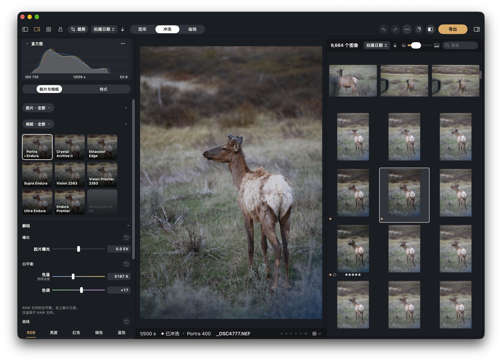

# SpektraLab 2.2.1 使用指南

[English](USER-GUIDE.md) · **简体中文**



这份指南讲的是 Mac 版 SpektraLab 2.2.1：每一部分做什么，在哪里找。文中**加粗**的名称就是 App 里显示的名称。

## 目录

1. [SpektraLab 是什么](#1-spektralab-是什么)
2. [安装与系统要求](#2-安装与系统要求)
3. [窗口](#3-窗口)
4. [图库](#4-图库)
5. [导入](#5-导入)
6. [冲洗](#6-冲洗)
7. [裁剪、拉直与透视](#7-裁剪拉直与透视)
8. [编辑](#8-编辑)
9. [半格组](#9-半格组)
10. [导出](#10-导出)
11. [观片台](#11-观片台)
12. [设置](#12-设置)
13. [智能体：命令行与 MCP](#13-智能体命令行与-mcp)
14. [键盘快捷键](#14-键盘快捷键)
15. [更新、版本与数据位置](#15-更新版本与数据位置)
16. [常见问题](#16-常见问题)

---

## 1. SpektraLab 是什么

SpektraLab 是 Mac 上的胶片暗房。打开一张照片，选好胶片和相纸，SpektraLab 就像暗房那样把照片“冲印”出来：光穿过胶片的染料层，胶片冲洗，再透过底片在相纸上曝光。颗粒、光晕（亮点周围的那圈光）等效果都是这个过程的一部分，并且会随胶片画幅的大小而缩放。成片以全分辨率生成。

它模拟的是一套物理过程，不是一组滤镜。背后的引擎是基于 Andrea Volpato 的 [spektrafilm](https://github.com/andreavolpato/spektrafilm)（GPL-3.0-or-later）派生的 C++/Metal 实现。

**它不做什么。** SpektraLab 不做修图：没有蒙版，没有画笔。成片之后，**编辑**只提供作用于成片的光、曲线和色彩调整，仅此而已。需要减淡、加深或仿制，请用别的软件。

**它能做什么：**

- 彩色负片、反转片、电影负片与拷贝片，彩色与黑白相纸。
- 由 SpektraLab 目录和会话组成的图库，带评级和色标。
- 只读的 Capture One 目录与会话。SpektraLab 绝不写回。
- 片边（片基、齿孔、边缘字与格号）、日期后背，以及半格组。
- 观片台：冲洗好的底片按真实尺寸摆放。
- 导出为 JPEG、HEIF、PNG 和 TIFF。
- 命令行与 MCP 服务器，供其他程序调用。
- English、简体中文、繁體中文和日本語。

**许可。** App 和引擎采用 GPL-3.0-or-later。彩色胶片与相纸的配置来自 spektrafilm（CC BY-SA 4.0）。黑白胶片及其相纸是 SpektraLab 自己的配置，依据厂商公开的数据手册制作，同样是 CC BY-SA 4.0。完整声明见**设置 › 通用 › 许可与致谢**。

---

## 2. 安装与系统要求

- **macOS 15 或更高版本**，**Apple 芯片**。
- 下载的是一个经过签名和公证的磁盘映像（DMG）。打开后，把 SpektraLab 拖进“应用程序”文件夹。
- DMG 是通用版本，也包含适用于 Intel Mac 的代码。但 **Intel Mac 没有经过测试**，可能能用，也可能不能用。受支持的机器是 Apple 芯片。
- 只有从源码自己构建 SpektraLab 时才需要 Xcode 27。日常使用不需要。
- 安装和运行都不需要 Python。

SpektraLab 免费且开源。

---

## 3. 窗口

SpektraLab 只有一个主窗口，布局如下：

- **左侧控制列。** 顶部是三个模式：**图库**、**冲洗**、**编辑**。模式下面是该模式的内容：图库里是边栏，冲洗和编辑里是直方图和各项控制。
- **照片**在中间。
- **浏览器**在右侧：当前汇集里的照片网格。三个模式共用它，所以冲洗时可以直接点另一张照片。
- **信息条**在照片下方，三个模式都有。它显示曝光、文件名、评级和色标；在冲洗和编辑中，还会说明冲洗的状态，例如“已冲洗”，后面跟着胶片和相纸。选了多张照片时，它显示选了几张。
- 顶部有一条**工具栏**。左边是各模式共用的按钮：**边栏**（隐藏或显示左侧控制列）、**查看器**（照片与网格并排，开或关）、**网格**（网格占满窗口）、**观片台**、**裁剪**和**排序**。窗口够宽时，模式切换在中间。冲洗和编辑里，右边是撤销、重做、“···”菜单、粘贴设置、对比和导出。

有四个页面占满整个窗口，不属于模式：**观片台**、**导入**、**导出**和**设置**。它们各有返回的办法。

几个顺手的习惯：

- 在浏览器里点一张照片就是选中它。在冲洗或编辑中，这会把它打开到画布上。
- 拖动左侧控制列与照片之间的分界线可以调整控制列的宽度，宽度会被记住。
- **设置 › 外观**可以设置浅色、深色或跟随系统，也可以设置背景色和界面缩放（80%、100%、120% 或 150%）。

---

## 4. 图库

图库列出你的照片。它参照 Capture One 的图库工具设计，如果你用过 Capture One，大部分会很眼熟。

### 4.1 来源

**来源**就是照片所在的地方。图库边栏顶部的来源选择器会列出它们：

| 来源 | 说明 |
|---|---|
| **SpektraLab 目录**（`.spkcatalog`） | SpektraLab 替你保管的目录。文件存在哪里由你决定，也可以有多个。默认情况下，导入目录时文件留在原处（引用）。 |
| **SpektraLab 会话**（一个文件夹，内含 `Capture`、`Selects`、`Output`、`Trash` 四个文件夹和一个 `.spksession` 文件） | 一次拍摄的工作文件夹。默认情况下，导入会话时文件会被拷贝进它的 `Capture` 文件夹。 |
| **Capture One 目录**（`.cocatalog`） | 单向读取，见 4.3。 |
| **Capture One 会话**（含 `.cosessiondb` 的文件夹） | 只把里面的图像文件当作文件夹列出来，不读取会话的数据库。 |
| **关联的文件夹** | 任何访达文件夹。SpektraLab 列出其中的照片，并让列表与文件夹保持同步。 |

**新建目录：** 用边栏下方的 **+** 菜单或来源选择器，选**新建目录…**，给它起个名字、选个位置。如果那个位置已有同名目录，SpektraLab 会请你换一个。**打开目录：** 在同一个菜单里选**打开目录或文件夹…**。它接受 `.spkcatalog`、SpektraLab 会话文件夹、`.cocatalog`、Capture One 会话文件夹，或任何其他文件夹（会成为关联的文件夹）。

第一次启动时如果还没有目录，图库会显示**还没有目录**，并提供**新建目录…**。

**关联的文件夹与保持同步的文件夹。** 选中这类来源时，以及你切回 App 时（最多每分钟一次），SpektraLab 会查看那个文件夹：

- 新文件会被加进来。
- 移动过的文件保留原来的那一行，所以评级、色标和编辑都还在。
- 不见了的文件会被隐藏，文件回来时它也回来。
- 所在磁盘没有连接的文件夹会标为未连接，其中的内容保持不变。

SpektraLab 绝不移动、重命名或删除你文件夹里的文件。想手动重读一个来源，在 **+** 菜单里选**重新读取**。**从列表中移除**只是把来源从列表里去掉，不会删除磁盘上的任何东西。

### 4.2 边栏

边栏有三个标签：**图库**、**过滤器**和**信息**。

**图库标签。** 该来源的汇集大纲，每项带数量：

- **目录汇集**：**全部图像**、**最近导入**（每次导入按各自的时间列出）、**最近拍摄**、**目录内**和**废纸篓**。
- **用户汇集**：项目、群组和相册。SpektraLab 自己的来源在这里有**收藏**。
- **文件夹**：文件夹树，每个文件夹挂在它的磁盘之下。

汇集的菜单里有**在冲洗中打开**。Capture One 自己的汇集名称保持 Capture One 的叫法。

**过滤器标签。** 勾选数值来缩小网格范围。可用的分类有**评级**、**色标**、**日期**（先年后月）、**相机**、**镜头**、**文件类型**和**关键字**（有的话）。SpektraLab 另加了一项自己的：**在冲洗中打开过**。每个数值旁边都有数量，是在其他勾选都生效的前提下算出来的。**清除过滤器**会清掉所有勾选。边栏底部的**过滤**输入框用来筛选当前标签里的行。

**信息标签。** 选中照片的详情：拍摄时间、相机和镜头、曝光、尺寸、胶片、是否已冲洗，以及原件的位置。

边栏顶部有**导入**和**导出**按钮。

### 4.3 Capture One 目录与会话

SpektraLab 可以在图库里显示 Capture One 的目录或会话，但严格是单向的。

- **目录**通过快照读取。SpektraLab 先把目录的数据库文件拷到一个临时位置，检查这份拷贝，然后只读这份拷贝。你的 `.cocatalog` 从不以写入方式打开。
- **没有任何东西会写回 Capture One。** 评级、色标、相册、废纸篓标记、文件，都不会写进 Capture One 的文件。
- 你在 SpektraLab 里设的**评级和色标**是 SpektraLab 自己的，保存在 SpektraLab 为这个目录保管的镜像里，Capture One 原来的评级仍留在旁边。你在冲洗和编辑里做的编辑同样只留在 SpektraLab。
- **Capture One 正在写入**目录时，SpektraLab 读不了。来源会显示 **Capture One 正在写入它：稍后再重新读取**。等一会儿，再选**重新读取**。
- **智能相册**会列出但呈灰色：SpektraLab 不计算 Capture One 的智能相册。Capture One 自己的相册也不能在 SpektraLab 里重命名或添加。
- **可以向 Capture One 来源导入。** 导入的文件成为镜像里属于 SpektraLab 的行，放在各自的**最近导入**条目下，目录再次读取之后它们仍在。
- **想在副本上工作**，用**拷贝到 SpektraLab 目录…**（在 **+** 菜单、来源选择器或**设置 › 来源**里）。它会新建一个 `.spkcatalog` 并打开，Capture One 来源仍留在列表里。之后用**从 Capture One 更新**带入变化；如果两边都改过同一处，以 SpektraLab 这一边为准。
- Capture One 的照片在第一次于冲洗中打开时才变成 SpektraLab 的画幅。浏览一个上万张的目录不会冲洗任何一张。

不支持 Lightroom。

### 4.4 网格

网格显示当前汇集里的照片。它的标题行有**排序**菜单（**拍摄日期**、**名称**、**评级**、**导入日期**、**添加日期**）、升序/降序按钮、数量、缩略图大小滑块，以及**搜索**输入框（搜文件名）。

每个格子在照片下方可以显示标记：评级、色标和胶片。

| 操作 | 效果 |
|---|---|
| 点按 | 选中一张 |
| ⌘-点按 / ⇧-点按 | 增减一张 / 选中一段 |
| 双击，或 Return | 在冲洗中打开 |
| 方向键 | 移动选择（按住 ⇧ 为扩展选择） |
| ⌘A、⇧⌘A、⌘I | 全选、取消全选、反向选择 |
| ⌘+ / ⌘− | 放大 / 缩小缩略图 |
| Delete | 移除所选照片在 SpektraLab 里的编辑和预览（会先询问，并说明哪些会一并移除） |

**格子的菜单**（辅助点按）有：**在冲洗中打开**、**放到观片台上**、**组成半格组**、**信息**、**导出**、**拷贝设置**、**粘贴设置**、**冲洗预览**、**收藏**或**取消收藏**，以及**从 SpektraLab 中移除**。选了多张时，导出、粘贴、收藏和移除作用于所有选中的照片。

从未冲洗过的照片，在你于冲洗中打开或导出它之前，显示的是文件自带的预览。预览做好之后编辑又变了的照片，会标上**预览不是最新**，用**冲洗预览**重新做一次。

### 4.5 评级与色标

- **评级：** 选中照片后按 **0** 到 **5**，所有模式下都可用。也可以点信息条里的星星。
- **色标：** **红**、**橙**、**黄**、**绿**、**蓝**、**粉红色**、**紫**，或者无。键 **−**、**\***、**+** 分别设为红、黄、绿。信息条里也有色标选择器。

评级和色标适用于 SpektraLab 目录与会话、关联的文件夹，以及 Capture One 来源（在那里它们是 SpektraLab 自己的，见 4.3）。

### 4.6 废纸篓

**从 SpektraLab 中移除**不会删除文件。它把照片放进所在来源的**废纸篓**汇集（在边栏的**目录汇集**里）。如果这张照片在 SpektraLab 里编辑过，会先询问，因为它的编辑和预览会一并移除。

进入**废纸篓**汇集后，格子的菜单会变：

- **放回原处**：把照片从废纸篓里取出，恢复原样。
- **移到废纸篓**：先询问，然后把文件移到**系统废纸篓**，仍可在访达中放回原处。这是 SpektraLab 唯一会从磁盘上拿走文件的做法，而且只有在目录的废纸篓汇集里才提供。

Capture One 来源没有 SpektraLab 的废纸篓，Capture One 目录里的任何东西都不会被移除。

（为了区分：“废纸篓”汇集是目录里的一个分类；“移到废纸篓”才是系统废纸篓。）

---

## 5. 导入

打开导入页面的方式有：边栏里的**导入**按钮、**+ › 导入…**、**文件 › 导入**，或 **⇧⌘I**。也可以把照片、文件夹或目录直接拖到窗口上；按住拖到窗口上方时，页面会提示**松手即导入**，随后 SpektraLab 带着你拖入的内容打开导入页。

这个页面参照 Capture One 的“导入图像”窗口。左边是设置，右边是找到的照片网格。

- **导入来源。** 点**选择…**挑选文件夹或照片。**包括子文件夹**默认开启。
- **导入哪些文件。** RAW、JPEG、HEIF、TIFF、PNG 和 DNG。附属文件和影片不导入。
- **导入到。** 一个 SpektraLab 目录或会话。默认是图库里当前选中的那个，没有的话是你上次打开的，再没有的话是**新建目录…**，它会在开始导入时于“图片”文件夹里创建一个“SpektraLab 目录”。
- **放置方式。** 对目录：**添加到目录**（文件留在原处）、**拷贝到文件夹…**（SpektraLab 把文件拷到你选的文件夹并添加这些拷贝，原件只读不动，也不会覆盖任何东西）、**拷贝到目录中**（放进目录自己的 `Originals` 文件夹，按日期整理）。对会话：**添加到会话**、**拷贝到会话的 Capture 文件夹**（默认），或**拷贝到文件夹…**。从其他 App 拖来的图片必须拷贝。
- **排除重复项。** 目的地里已有的文件（路径相同，或名称和大小相同）会变灰，不会导入。
- **分类。** 每次导入在**最近导入**下形成一个条目。
- **过滤器。** 可按**格式**和**拍摄日期**缩小显示范围。
- **选择。** 网格的用法和图库一样：点按、⌘-点按、⇧-点按、框选。没有选中任何照片时，按钮写着**全部导入（n）**；选了一些时写着**导入所选的 n 个**。Esc 取消。

导入本身不冲洗任何东西。照片要等你在冲洗中打开、给它粘贴设置，或导出它的时候才会冲洗。

---

## 6. 冲洗

在模式行里选**冲洗**。直方图下面，控制列有两个标签：**胶片与相纸**和**格式**。几个常用按钮（“···”菜单、撤销、对比、导出）在顶部工具栏里。

SpektraLab 不做实时渲染。拖动时数字跟着指针走，照片在你停手或松开时才生成。只影响冲印的设置会用同一张底片很快重新冲印；影响胶片的设置，在你松手后重新冲洗。信息条会告诉你它正在做什么。

### 6.1 胶片与相纸

两条卡片带，下面是**解码**。

**胶片带与相纸带。** 每张卡片显示你的照片经过这款胶片、或印在这款相纸上的样子。点一张卡片就是选它。每条带都有一个带菜单的小标签，**胶片 · 全部**和**相纸 · 全部**，用来把这条带缩小到某个分类。胶片的分类有**全部**、**负片**、**正片**、**电影**和**黑白**；相纸的分类有**全部**、**标准**和**黑白**。每条带右边的小箭头可以把它收起，收起状态会被记住。用滚轮或触控板可以横向滚动一条带。

搭配规则来自物理，卡片会把它们表现出来：

- **负片要印在相纸上。** 选一款胶片时，它会带上自己的相纸。在相纸带里，这张相纸的卡片上有一个胶片颜色的小圆点，意思是“这款胶片的推荐相纸”。你也可以选别的。
- **反转片（正片）只扫描，不冲印。** 它没有相纸，所有相纸卡片都变灰。页面上写着“反转片只扫描，不冲印。”
- **银对银，彩色对彩色。** 黑白胶片只能印在黑白相纸上，彩色胶片只能印在彩色相纸上。印不了当前胶片的相纸会变灰，无法选择。

冲洗进行时，卡片上会转圈。如果某张卡片没能生成，会出现重试标记，可在它的菜单里选**重试**。

**应用胶片模拟。** 解码下面的一个开关。关掉后，胶片和相纸变灰，照片就是苹果自己对文件的解码，编辑仍然作用在上面。胶片曝光、解码曲线、片边、日期后背和各项效果都会停用，因为没有胶片。白平衡仍然可用。半格组没有这个开关。

**数字中间片卡片。** 在彩色负片下，相纸带的最后一张卡片是**数字中间片**。它不是相纸。选了它，底片不再被冲印，而是被扫描：得到一张平淡、中性的底片扫描，没有相纸的反差，就像冲印店在调色之前交给你的那种文件。你之前选的相纸会被保留在下面。想回去，选任意一张相纸卡片，那张相纸就重新印出来。反转片和黑白胶片下不提供这张卡片。

**解码。** 照片进入胶片之前对场景做的处理。它的标题行可以折叠，里面有三部分，每部分有自己的还原按钮（↺）：

- **曝光**：**胶片曝光**，范围 −8 到 +8 EV。它改变底片得到的光量。这不是亮度控制：放大机会重新校时，所以成片的中灰并不会简单地跟着它走。
- **白平衡**：**色温**（2000–10000 K）和**色调**。只适用于 RAW 文件。JPEG 或 TIFF 的白平衡在相机里就定好了。相机自己的设置叫**原照设置**。
- **曲线**：作用于进入胶片之前的场景，横纵轴以测光中灰为中心，单位是档（±8）。它取代了原来的场景安置。以前设过场景安置的照片会保留它，所以画面不会变，冲洗的“还原”会把它去掉。

胶片与相纸的 ↺ 会把整个解码还原。

**测光。** SpektraLab 自己给每张照片测光，胶片曝光是在测光的基础上再加。所以粘贴设置时，粘过去的不是为另一张照片算出来的数值：每张照片自己测自己的曝光。

**镜头校正**（RAW 文件里镜头的畸变与暗角配置）是对所有 RAW 照片一并生效的设置，在**设置 › 冲洗 › 镜头校正**里。

**放大机。** Mac 版 2.2.1 没有放大机的控制项。以前编辑过印放亮度、滤色片偏移或预闪的照片，仍按那些数值冲印，所以画面不会变。“···”菜单里的**还原**（在这个标签里叫“冲洗”）可以把它们归零。

### 6.2 格式

第二个标签**格式**，讲的是胶片的画幅，以及曝光到它上面的东西。

**胶片尺寸。** 卡片有 **110**、**APS**、**135** 和 **120**。尺寸告诉 SpektraLab 你的画幅在胶片上有多大（毫米），颗粒、光晕和成色剂扩散都按它缩放。画幅越大，颗粒越细。开启片边后，尺寸改由片边的画幅决定，这几张卡片会停用。

**片边。** 一个带折叠的开关。打开后，画面印在它自己的胶片上：片基、齿孔、该款胶片的边缘字和格号，就像扫描整条底片那样。开关下面有：

- **调整取景**：打开裁剪页。开启片边后，裁剪框就是胶片的片门，你在它下面移动和放大画面。
- **格式**：135、半格、645、6×6、6×7、6×8、6×9、XPan、6×12 或 6×17。所选胶片从未做过的画幅会显示出来但不能选，页面会说明原因。
- **视图**：**片条**（胶片的整个宽度）或**锉边**（画幅周围留一线片边）。
- 边缘工具：**片门**（画幅角的形状，由相机机身决定）、**齿孔**（**无**、**白**或**黑**；120 没有齿孔）、**边缘灰雾**、**片轴漏光**，以及边缘字的**亮度**。**机身**说明这卷胶片是用哪台相机拍的，**换一台**换一个机身。**格号**和**过片**设定格号。
- **旋转 90°**：旋转胶片。

**日期后背。** 也是一个带折叠的开关。它像相机的日期后背那样，把日期曝光到底片上。你可以选字样（**LCD**、**点阵**，或**数据**，后者把快门和光圈印在两格之间，需要片边）、**边角**、**尺寸**和**亮度**。所选画幅从没印过的字样不能选。

**移除防光晕层。** 一个开关，页面标注为“实验性功能”，对所有胶片都适用。它把胶片的防光晕层从模拟里拿掉。

**效果。** 五个标尺，顺序如下：

| 效果 | 作用 |
|---|---|
| **颗粒** | 颗粒强度。1.00× 是这款胶片本来的样子。 |
| **光晕** | 亮点周围的那圈光，来自穿过胶片又反射回来的光。1.00× 是胶片本来的样子。 |
| **散射** | 光在乳剂层内扩散的程度。0 为无。 |
| **眩光** | 相纸的那层雾：光在照片上散开。没有冲印时（扫描没有相纸）呈灰色。 |
| **成色剂** | 胶片各感光层相互抑制的强弱（DIR 成色剂）。1.00× 是胶片本来的样子。 |

格式标签的 ↺ 会还原画幅、效果和成色剂，但不会动片边和日期后背——它们有各自的开关。

**记住：** 胶片或相纸的配置是实测的结果。SpektraLab 不提供改写材料本身的控制，滑块只移动暗房里真正能移动的东西。

### 6.3 拷贝、粘贴与预设

**拷贝设置**取下一张照片的设置，以便粘贴到别的照片上。

- **⌘C** 按你上次勾选的分组，拷贝当前打开的照片（在图库里是选中的照片）的设置。**⇧⌘C** 先打开**拷贝设置**面板，让你选择分组。
- 分组有：**胶片与相纸**、**胶片曝光**、**格式**、**片边与日期后背**（一开始不勾选）、**放大机**、**解码**、**成色剂**、**预闪**、**光**、**曲线**和**色彩**。面板在每个分组名下，会显示这个分组在这张照片里的内容。
- **⌘V**（或粘贴按钮**粘贴设置**）粘贴到当前打开的照片；在图库里则粘贴到所有选中的照片。粘贴的是设置，不是算好的数值：每张照片自己测光，白平衡为“原照设置”时保留自己的。裁剪、取景和片边的种子永远不会被带过去。如果粘贴的胶片或相纸在这个版本里不存在，会提示**材料不可用**。
- 在图库里粘贴后，这些照片的预览会重新冲洗（边栏显示“正在冲洗 N 张照片”，带**停止**按钮）。
- 在你拷贝之前，粘贴按钮是灰的，提示**还没有拷贝任何设置**。

**预设**（在“···”菜单里）用一个名字保存一种风格。**保存预设**会保存当前照片所选分组的设置。点一个预设就应用它。每个预设有**重命名**和**删除**，**撤销删除**可以找回刚删除的那个。

### 6.4 对比、原图、撤销与重做

- **对比**（顶部工具栏的按钮，或按 **Y**）把照片分成两半：一边是解码后的原图，另一边是冲洗后的照片。拖动分界线调整。对按钮做辅助点按，可以单独显示**原图**或**成片**。
- 按住**空格键**，松开前一直显示原图。
- **撤销**和**重做**（⌘Z、⇧⌘Z）逐步回退你的编辑。拖一次滑块算一步。
- **还原**（⌘R，或在“···”菜单里）把当前标签里的内容恢复原样，会先询问。

### 6.5 “···”菜单

顶部工具栏里圆形的“···”按钮（名为**编辑操作**）里有：**撤销**、**重做**、**还原**、**拷贝设置**、**预设**和**设置**（打开设置页面）。

### 6.6 画布色域

画布以 Display P3 显示照片，这是 Mac 屏幕能显示的最宽色域。**画布色域**让你按另一种色彩空间的文件来审视它。可选 **ProPhoto RGB**、**Display P3**、**Adobe RGB** 和 **sRGB**。

- **ProPhoto RGB** 和 **Display P3** 显示的是照片本来的样子。在 Display P3 屏幕上两者看起来一样。这个选择只是表明你正在为哪种色彩空间做判断。
- **Adobe RGB** 和 **sRGB** 是**打样**：用 SpektraLab 自己的色域压缩把照片转进那个空间，显示该空间的导出文件会是什么样。浓烈的颜色可能看起来没那么饱和。编辑本身没有任何改变。

这只影响画布，绝不改变编辑或导出。导出页面有它自己的打样，跟随配方（见第 10 节）。

### 6.7 缩放

滚动或双指开合来缩放。**,** 让照片适合窗口，**.** 以实际大小（1:1）显示，⌘+ 和 ⌘− 放大和缩小。放大超过预览尺寸后，SpektraLab 会为你正在看的部分生成全尺寸图像，大文件可能要稍等一下。

### 6.8 直方图

直方图在冲洗和编辑的控制列顶部。它显示的是你看到的照片，有红、绿、蓝和明度通道。可以选 **Capture One 风格**或 **SpektraLab 风格**，也可以把曲线图收起。

---

## 7. 裁剪、拉直与透视

有两种裁剪，它们回答的是不同的问题。

- **冲洗的裁剪**裁的是**底片**：进入胶片之前的画面（页面上称为**原图**）。胶片和决定曝光的测光，只看到你留下的部分。默认情况下（**设置 › 冲洗 › 裁剪重新映射画幅**关闭），裁剪相当于只看同一张底片的一部分，所以裁剪占满画面时，颗粒会跟着一起放大。
- **编辑的裁剪**裁的是**成片**，在冲印之后。

在你想要的模式里按 **C**（或点顶部工具栏的**裁剪**）。在图库里，**裁剪**按冲洗的裁剪来裁选中的照片。

裁剪页有：

- **宽高比**：**自由格式**、**原始比例**、**正方形**，以及常用比例（3:2、4:3、16:9、5:4、7:5），还有把裁剪框竖起或横放的按钮。锁定会保持比例。
- **拉直**：**角度**标尺（最大 45°）。也可以按住 **⌘**，沿着本应水平或竖直的地方拖一条线。
- **透视**：**垂直**和**水平**标尺（最大 30），以及**参考线**。参考线让你标出应当水平的两条线（**横向平行线**）、应当竖直的两条线（**竖向平行线**），或应当是矩形的四个角（**矩形**），然后点**应用**。
- **旋转与翻转**：**向左旋转**和**翻转**。
- **还原**把这一节恢复原样，**完成**保留裁剪。

开启片边后，裁剪页显示胶片的片门，你在它下面摆放画面。拉直和透视仍然可用。

---

## 8. 编辑

在模式行里选**编辑**。编辑作用于冲印好的成片，并且跟手：没有渲染任务，因为它由 Mac 的图形芯片直接作用在冲洗好的照片上。它绝不会回头影响胶片或相纸。直方图在顶部。

控制列里是一片瓷砖。点一块瓷砖，打开它的控制。打开的瓷砖有一条工具栏：垃圾桶（把这个工具归零）、撤销、工具名和**完成**。

| 分组 | 瓷砖 |
|---|---|
| **光** | **亮度**（亮度与曝光）、**对比度**、**色调**（**高光**、**阴影**、**白色色阶**、**黑色色阶**）、**暗角**（强度与**中点**） |
| **曲线** | **曲线** |
| **色彩** | **HSL**、**通道**、**色轮**、**鲜艳度**、**饱和度**、**色温**（色温与色调） |

- **曲线**：**控制点**曲线或**参数**曲线，可作用于**明度**，也可分别作用于**红**、**绿**、**蓝**。点曲线添加控制点；选中一个点后按 Delete 删除。**重置通道**可恢复一个通道。
- **HSL**：选一种颜色（红、橙、黄、绿、青、蓝、紫、品红），调整它的色相、饱和度和光。
- **通道**：红、绿、蓝输出的混合器。
- **色轮**：高光、中间调、阴影各有一个色轮，另有**明度**滑块，以及整体调整。

编辑的裁剪就是第 7 节说的成片裁剪。**作为拷贝分组：** 光、曲线和色彩是拷贝设置里的三个分组（见 6.3）。

因为编辑作用在冲印之后，大幅调整可能会把冲印时保住的高光或阴影压掉。小幅调整，并看着直方图。

---

## 9. 半格组

半格相机在一格 135 胶片上拍两张，SpektraLab 也可以。**半格组**把两张照片放在同一条胶片上，各有自己的曝光、白平衡和印放。

**怎么做：** 在图库里选一两张照片，打开照片的菜单，选**组成半格组**。选两张时，半格组会作为一张独立的“半格组”出现在图库里；选一张时，SpektraLab 会请你再选另一张。

**半格组的页面。** 冲洗会在这个组上打开。用一个切换选择你正在编辑的对象：左格（如果是竖放，则是上格）、**胶片**，或右格（下格）。胶片与相纸和各项效果属于胶片（两格共用一块胶片）。曝光、白平衡和印放可以逐格设置。

在**格式**里，半格组有自己的面板：

- **片边**和**日期后背**对整条胶片是开或关。放在片条上的半格组是两个半格，每格 18 × 24 毫米，相隔一毫米。
- **相机**：**横放**或**竖放**，以及两格之间的**间距**。
- **添加照片**、**替换照片**、**对调两格**。
- 某一格的曝光可以只作用于**仅此格**，也可以连同胶片一起（**+ 胶片**）。它的测光可以开或关。

空着的一格是未曝光的胶片，两格都填上才能导出。半格组并不拥有照片：如果你把某张照片从图库里移除，半格组里它的那一格会显示为缺失，换上别的照片之前不能导出。

---

## 10. 导出

打开导出的方式有：冲洗和编辑工具栏里的**导出**按钮、图库边栏的**导出**按钮、照片的菜单，或 **⇧⌘D**。导出处理浏览器里选中的照片，按网格的顺序；选中不到两张时，处理当前打开的照片。

页面左边是各项控制，右边是预览（图库的查看器和格子）。

### 10.1 配方

**配方**是一组有名字的设置：格式、尺寸、色彩空间、质量，以及文件存到哪里。SpektraLab 自带五个：

- JPEG · sRGB
- JPEG · Display P3
- HEIF · Display P3
- TIFF 16 位 · ProPhoto
- PNG · sRGB

页面顶部的小标签用来选配方。**＋ 新建**把当前设置存成一个有名字的配方（名字留空的话，按格式命名）。配方可以在这里或**设置 › 导出**里重命名、修改或删除。

### 10.2 各项控制

- **格式。** **JPEG**、**HEIF**、**PNG** 或 **TIFF**。JPEG、HEIF 和 PNG 每通道 8 位，TIFF 为 16 位。
- **尺寸。** **全尺寸**（原件自己的尺寸）、**12 MP**、按像素指定的**长边**或**短边**。永远不会比原件大。每种尺寸都从原件重新冲洗，所以导出的从来不是放大的预览。如果原件没有连接，只提供预览尺寸，文件名里会带 `_preview`。如果文件太大，你的 Mac 无法完整冲洗，它会被缩小并如实标明，绝不冒充全尺寸。
- **色彩。** **sRGB**、**Adobe RGB (1998)**、**Display P3** 或 **ProPhoto RGB**。SpektraLab 只转换一次，从它的工作空间转到你选的空间，用色域压缩而不是硬截断，文件里带有该空间的描述文件。
- **质量。** 100、95、90、85、80 或 75，适用于 JPEG 和 HEIF。PNG 和 TIFF 保留每一个数值，所以这一行写着“无损”。
- **存储到。** **文件**或**共享**。
  - 选**文件**时，**文件夹**只需选一次，SpektraLab 会记住。每个文件用照片的文件名加上格式的扩展名。名字已被占用时，新文件会加上“-2”，绝不覆盖。
  - 选**共享**时，做好的文件在结束时交给 Mac 的共享面板。

### 10.3 色彩空间在实际中意味着什么

- **sRGB** 是网页和发给别人的安全选择，空间最小。
- **Display P3** 是近年 Mac 屏幕能显示的范围，适合在苹果屏幕上观看。
- **Adobe RGB** 供部分要求它的打印机和工作流程使用。
- **ProPhoto RGB** 最宽，也是 SpektraLab 的工作空间。如果还要继续调色，请搭配 **TIFF 16 位**使用。8 位的 ProPhoto 步距很大，平滑的影调（比如天空）可能出现色带，页面会提醒你。

导出页的**预览**跟随配方的色彩空间。把配方从 Display P3 换成 sRGB，预览就会打样到 sRGB，写出文件之前就能看到 sRGB 文件的样子。

### 10.4 批量导出

点**导出**。SpektraLab 逐张从原件重新冲洗，每张完成后写出文件。每个文件先以隐藏的临时名字写出，完整之后才移到位，所以崩溃也不会留下写了一半的文件。

- **停止**会让已完成的文件保持完整。
- 无法导出的照片（文件丢了、磁盘不在、读不出来）会在它那一行写明，其余的继续。
- 关闭页面后，导出仍会继续。请保持 SpektraLab 打开，直到完成。
- 结束时，**在访达中显示**会打开那个文件夹。
- 如果 SpektraLab 已经保留着一份可用的全尺寸图像，导出会直接用它，不再重新冲洗。

---

## 11. 观片台

观片台是一块从上往下看的灯箱，你冲洗好的底片按**真实尺寸（毫米）**摆在上面。它用来像在真正的灯箱上那样看、排和比较底片。

**怎么打开。** 点共用工具栏里的**观片台**（会把选中的照片放上去）；在图库里选中照片后按 **P**；用照片菜单里的**放到观片台上**；或选**前往 › 观片台**（⇧⌘L）。

**什么能放上去。** 只有在 SpektraLab 里冲洗过、并且记录了胶片尺寸的照片：开启了片边的照片，或半格组。没有胶片尺寸的照片不会被放上去，添加页面会说明这一点。观片台最多放 99 张底片。

**工具栏。**

- **拖移**或**点击**（快捷键 **D** 和 **C**）。在**拖移**模式下，拖动底片来移动它。在**点击**模式下，点一下底片拿起，再点一下放下；**Esc** 放回原处，拖动到边角之外一点可以旋转（按住 ⇧ 为 15° 一档）。
- **放大镜**（L）：放大指针下的画面。
- **−**、**适合**、**+**（快捷键 **−**、**0**、**=**）：缩小、缩放到适合窗口、放大。
- **实际大小**（1）：按你显示器上的真实大小显示底片。这需要显示器报告自己的尺寸。
- **观片台尺寸**和**观片台方向**：A4、A5 或 A6，竖向或横向。底片在每种尺寸上都保持自己的毫米尺寸。
- **整理**、**随机**、**散射**和**全部取下**。
- **撤销**。
- **共享**：生成一张观片台图片来分享，样式为**海报**或**印样**。
- 右侧的栏（⌥⌘0）列出台上的底片。**添加照片**打开一个长得像导入的页面，在那里选择要放下的照片。**铺开**用来整理；**清除**把所有底片取下。

**对一张底片**（辅助点按，或用快捷键）：**向右旋转**（R）、**向左旋转**（⇧R）、**取下**（Delete）。方向键把选中的底片移动 1 毫米（按住 ⇧ 为 10 毫米）。Return 在冲洗中打开它。

**细看**或**放大到底片**时，SpektraLab 读取全尺寸图像，没有的话就生成一份。

---

## 12. 设置

用 **⌘,**、“···”菜单或 **+ › 设置**打开设置。它是占满窗口的页面，有七个部分。

### 通用

- **语言。** English、简体中文、繁體中文或日本語，每种都用它自己的文字显示。SpektraLab 立刻切换；macOS 自己显示的东西（例如访达面板）要等下次打开 App 才会跟着变。第一次启动时，App 会采用你系统的首选语言。
- **智能体。** **允许智能体使用 SpektraLab**，默认关闭。见第 13 节。下面是这份 App 的命令行和 MCP 服务器的命令，以及**拷贝 MCP 配置**。
- **更新。** **自动检查更新**（默认开启）和**立即检查**。见第 15 节。
- **关于。** **版本**、**许可与致谢**，以及**致谢**（会打开自己的页面）。

### 外观

**模式**（**跟随系统**、**浅色**或**深色**）、**背景**（每种模式各有一个颜色，可**恢复默认**），以及**界面缩放**（80%、100%、120% 或 150%）。缩放同时作用于所有页面。

### 冲洗

- **新照片。** 新照片起始使用的**胶片**和**相纸**，或**上次使用**。这一对永远是照片可以拥有的组合：选一款胶片会带上它自己的相纸，种类不对的相纸会被拒绝。照片会保留它来时的那一对。
- **冲洗。** **预览尺寸**（长边 1,600、1,920、2,400 或 2,560 像素）：图库和冲洗页面里每张照片冲洗的尺寸，只作用于此后新到的照片。**镜头校正**（仅 RAW：镜头的畸变与暗角配置，macOS 有的话才有；Sony RAW 和 Apple ProRAW 文件不受影响）。**裁剪重新映射画幅**（默认关闭，见第 7 节）。
- **片边。** **机身**：每个新片边所用的相机机身。**换一台**换一个。照片保留它被分配到的机身。

### 导出

配方在这里就地编辑：先选一个，再修改它的**名称**、**格式**、**尺寸**、**色彩**、**质量**和**存储到**。**新建配方**和**删除配方**用来增删。打勾的配方就是导出页面打开时使用的那个。删除配方不会动你已经导出的文件。

### 来源

你的目录、会话和文件夹，以及它们的状态（**已连接**、**未连接**、**Capture One 正在写入它：稍后再重新读取**，或**已在另一个 SpektraLab 中打开**）和图像数量。每一项有一个操作菜单：**在图库中显示**、**重新读取**、**在访达中显示**、**从列表中移除**；Capture One 来源还有**拷贝到 SpektraLab 目录…**和**从 Capture One 更新**。从 Capture One 拷贝来的目录会显示“拷贝自 … · 更新于 …”，并带有**立即更新**。页面底部重申规则：SpektraLab 绝不改动或删除你文件夹里或 Capture One 目录里的任何东西，编辑留在 App 里。

如果你用过 SpektraLab 的早期版本，原来的图库会作为目录提供：**SpektraLab 图库将成为一个目录**（**放入目录**）。不会移动、拷贝或删除任何照片，目录在原处读取每一张。**以后再说**会推迟到下次启动；设置 › 来源里的**放入目录…**可以再次提供。

### 储存空间

SpektraLab 在这台 Mac 上占用了多少空间，用一根条和每个部分的一行来表示：

| 部分 | 是什么 | 可以清理吗 |
|---|---|---|
| **拷贝进来的原件** | 你选择拷贝进 SpektraLab 的文件。 | **不可以。** 它可能是唯一的一份，永远不会被清理。 |
| **工作副本** | 为全尺寸冲洗而拷到这里的原件。 | 可以，用**清除工作副本**。需要时会重新生成。 |
| **预览副本** | 不在任何图库里的照片的预览，以及冲洗页面的卡片。 | 可以，超出你设的上限后按时间淘汰。 |
| **文件夹和 Capture One 的预览** | SpektraLab 为关联的文件夹和 Capture One 来源保管的预览。 | 可以，用**删除预览**。 |
| **全尺寸冲洗结果** | 你最近看过的照片的全尺寸冲洗图。 | 可以，超出上限后最久没用的先清走。 |
| **缩略图和缓存** | 需要时会重新生成。 | 可以。 |

你可以给**工作副本**（2、5、10、20 或 50 GB）、**预览副本**（5、10、20 或 50 GB）和**全尺寸冲洗结果**（2、4、8、16、32 或 64 GB）设置上限。

目录或会话会把它所含照片的预览保存在自己里面（`Cache/Previews`），和 Capture One 一样，所以预览会随它一起走。**删除预览**会删除所选图库的预览——对每一台打开这个图库的 Mac 都是如此，所以会先询问。编辑会保留，预览在需要时重新生成。**位置**显示 SpektraLab 保存数据的文件夹，旁边有**在访达中显示**。

### 诊断

SpektraLab 会记一份运行日志，日志在这台 Mac 上保留 7 天。

- **导出日志压缩包**把日志文件交给你，想发给别人的话由你自己发。
- **在访达中显示**显示日志的位置。
- **日志里有什么**：这台 Mac 的型号、macOS、语言与地区设置、内存、低电量模式与发热，以及这个版本的设置；每次冲洗和导出（尺寸、耗时、用了多少内存、是否完成）；App 运行时的内存；用数字描述的图库（多少张、尺寸、相机、占用的空间）；你用了什么（胶片和相纸、改过的设置、导出的格式）；以及出了什么问题（错误、崩溃报告）。每一行都带有时间和这台 Mac 相对 UTC 的偏移。
- **日志不包含**：你的照片、它们的文件名、拍摄地点、图库里照片的拍摄时间、你的姓名、你的 Apple 账户。
- 带有日志服务器的版本还会有**与 SpektraLab 共享日志**，在你打开之前是关闭的。没有它的话，导出日志压缩包是日志离开这台 Mac 的唯一途径。
- **隐私政策**会打开 spektralab.app。
- **此版本**：版本、引擎，以及此刻一次冲洗会分到的内存上限。

---

## 13. 智能体：命令行与 MCP

你 Mac 上的其他程序（比如 AI 智能体）可以通过命令行或 MCP 服务器使用 SpektraLab。两种方式都是和正在运行的 App 通信，所以操作的就是你看到的那个图库。

### 13.1 打开它

访问**默认关闭**。请打开**设置 › 通用 › 智能体 › 允许智能体使用 SpektraLab**。每次调用都会重新读取这个设置：关闭时，所有调用都会被拒绝，连列表也不例外。

SpektraLab 没在运行时，第一次调用会在后台把它打开并等待（最多 30 秒）。

### 13.2 命令行

程序就是 App 自己的可执行文件，设置里会显示你这份 App 的确切路径。App 放在“应用程序”里时是：

```sh
/Applications/SpektraLab.app/Contents/MacOS/SpektraLab cli tools           # 工具列表，附每个工具的 JSON 结构
/Applications/SpektraLab.app/Contents/MacOS/SpektraLab cli help
/Applications/SpektraLab.app/Contents/MacOS/SpektraLab cli <工具> '<json>'  # 一次调用
```

一次调用接受一个 JSON 对象（要作为一个整体加引号），并输出一个 JSON 对象。退出码 **0** 表示完成，**1** 表示失败（连不上 App、导出出错），**2** 表示被拒绝（访问关闭、参数不对、来源只读）。调用在改动任何东西之前会被完整检查，所以参数打错只会被拒绝，不会改了一半。

### 13.3 MCP 服务器

`SpektraLab mcp` 是一个通过标准输入输出通信的 Model Context Protocol 服务器（JSON-RPC，每行一条消息）。**设置 › 通用 › 智能体**里的**拷贝 MCP 配置**会拷贝这份 App 对应的 `mcpServers` 条目，可以粘贴进 MCP 客户端的配置。

### 13.4 工具列表

一张照片的写法是 `"<来源 id>/<图像 id>"`，和 `list_images` 给出的一致。

| 工具 | 作用 |
|---|---|
| `list_sources` | 列出来源：id、名称、类型、状态、图像数量、是否只读，以及哪个被选中。 |
| `open_source` | 按 id 选中一个来源，或按路径从磁盘打开一个（目录、会话或文件夹）。 |
| `create_catalog` | 新建 `<文件夹>/<名称>.spkcatalog` 并选中它。 |
| `create_session` | 在某个文件夹里新建一个会话并选中它。 |
| `list_collections` | 列出一个来源的汇集，顺序同窗口。 |
| `list_images` | 列出某个汇集的照片，可按文件名、最低评级、色标过滤，可分页（每次最多 500 张）。包含胶片、相纸和冲洗状态。 |
| `import_images` | 把文件或文件夹导入目录或会话，引用或拷贝均可。 |
| `trash_images` | 把照片移入所在来源的废纸篓汇集，不动任何文件。 |
| `restore_images` | 把照片从废纸篓汇集里取出。 |
| `set_rating` | 设置星级，0 到 5。 |
| `set_color_label` | 设置色标（`none`、`red`、`orange`、`yellow`、`green`、`blue`、`pink`、`purple`）。 |
| `list_recipes` | 列出导出配方。第一个是 `export_images` 的默认配方。 |
| `export_images` | 用某个配方把照片导出到一个文件夹，每张都从原件重新冲洗。会一直等到整批结束。 |
| `list_stocks` | 按 id 列出胶片和相纸，以及数字中间片。 |
| `get_develop` | 一张照片的胶片、相纸、数字中间片、胶片曝光和冲洗状态。 |
| `set_develop` | 像胶片带和相纸带那样，改一张照片的胶片、相纸、数字中间片或胶片曝光（−8 到 8）。 |

列表类调用也会在窗口里选中它列出的内容，你可以看着它工作。没有观片台相关的工具。

### 13.5 安全规则

- **只动废纸篓。** `trash_images` 和 `restore_images` 只是把照片移入、移出图库的废纸篓汇集。没有任何工具能把文件移到系统废纸篓、清空废纸篓，或删除文件和来源。SpektraLab 绝不会通过这扇门删除文件。
- **Capture One 只读。** 对 Capture One 来源，智能体可以设置评级和色标（那是 SpektraLab 自己的，存在镜像里），其余什么都不会写入。
- **搭配规则照旧。** 装载胶片、选择相纸，和胶片带、相纸带的做法一致：反转片只扫描，银对银，彩色对彩色。印不了该胶片的相纸会被拒绝。
- **导出批量进行时**，会改动照片或从照片生成文件的工具（`set_develop`、`export_images`）会被拒绝。
- 原始文件从不被写入。
- 连接走的是你自己临时文件夹里的一个私有套接字，只有你能访问。

### 13.6 一个完整的例子

新建一个目录，导入两个文件，打分，再导出。先把路径设一次：

```sh
SL=/Applications/SpektraLab.app/Contents/MacOS/SpektraLab

$SL cli create_catalog '{"name":"春天散步","folder":"/Users/me/Pictures"}'
$SL cli import_images '{"paths":["/Users/me/Desktop/DSC0001.ARW","/Users/me/Desktop/DSC0002.ARW"]}'
$SL cli list_images '{}'
```

`create_catalog` 同时会选中新目录，`import_images` 导入到被选中的来源，并把文件按原位置引用。`list_images` 会给出每张照片的 id，形如 `<来源 id>/<图像 id>`。下面用这些 id：

```sh
$SL cli set_rating '{"images":["<来源 id>/<图像 id 1>","<来源 id>/<图像 id 2>"],"rating":4}'
$SL cli list_recipes
$SL cli export_images '{"images":["<来源 id>/<图像 id 1>","<来源 id>/<图像 id 2>"],"folder":"/Users/me/Desktop/春天散步导出"}'
```

不指定的话，`export_images` 用第一个配方；也可以传 `"recipe": "<list_recipes 里的名称>"`。文件夹不存在会被创建，已有同名文件时，新文件名后加“-2”。

---

## 14. 键盘快捷键

这些是 Capture One 的默认快捷键，在 Mac 已占用的地方做了少量调整。不带 ⌘ 的键，在没有文本框占用键盘时有效。

### 主窗口里通用

| 按键 | 作用 |
|---|---|
| ⌘, | 设置 |
| ⇧⌘I | 导入 |
| ⇧⌘D | 导出 |
| ⇧⌘L | 观片台（“前往”菜单） |
| ⌘B 或 ⌥⌘B | 显示或隐藏浏览器（网格旁的查看器） |
| ⌘T 或 ⌃⌘S | 显示或隐藏左侧控制列 |
| G | 网格占满窗口 |
| ⌥⌘V | 网格旁的查看器 |
| F | 全屏 |
| C | 裁剪 |
| P | 把选中的照片放到观片台上 |
| Y | 对比（冲洗与编辑） |
| ⌘A / ⇧⌘A / ⌘I | 全选 / 取消全选 / 反向选择 |
| ⌘← ⌘→ | 上一张 / 下一张 |
| ⌘Home ⌘End | 第一张 / 最后一张 |
| ← → | 冲洗与编辑里切换上一张/下一张；图库里移动选择 |
| 0 到 5 | 评级 |
| − \* + | 红、黄、绿色标 |
| ⌘C | 拷贝设置（沿用上次勾选的分组） |
| ⇧⌘C | 拷贝设置，并选择分组 |
| ⌘V 或 ⇧⌘V | 粘贴设置 |
| ⌘Z / ⇧⌘Z | 撤销 / 重做 |
| ⌘R | 还原当前标签 |

### 图库

| 按键 | 作用 |
|---|---|
| ⌘1、⌘2、⌘3（或加 ⌥） | 图库、过滤器、信息标签 |
| ⇧⌘F | 过滤器标签 |
| Return | 在冲洗中打开 |
| Delete | 移除所选照片在 SpektraLab 里的编辑和预览（会先询问） |
| Esc | 取消全选 |
| ⌘+ / ⌘− | 放大 / 缩小缩略图 |
| ⇧ 加方向键 | 扩展选择 |

### 冲洗与编辑

| 按键 | 作用 |
|---|---|
| , | 适合画面 |
| . | 实际大小（1:1） |
| ⌘+ / ⌘− | 放大 / 缩小 |
| 空格（按住） | 显示原图 |
| Delete | 删除曲线上选中的点 |

### 观片台

| 按键 | 作用 |
|---|---|
| D 或 H，C 或 V | 拖移模式，点击模式 |
| L（或 P） | 放大镜 |
| , 或 0 | 适合 |
| . 或 1 | 实际大小 |
| = 或 +，− | 放大，缩小 |
| R，⇧R | 向右旋转，向左旋转 |
| Delete | 取下选中的底片 |
| 方向键 | 把选中的底片移动 1 毫米（⇧ 为 10 毫米） |
| Return | 在冲洗中打开这张底片 |
| ⌥⌘0 | 右侧栏 |
| Esc | 把拿起的底片放回 |

菜单栏里的**键盘快捷键**菜单，会列出当前页面上有效的按键。

---

## 15. 更新、版本与数据位置

### 更新

SpektraLab 2.2.1 能告诉你有没有新版本，但它自己从不下载、也不安装任何东西。

- **自动检查更新**（**设置 › 通用 › 更新**，默认开启）：App 打开几秒钟后检查一次，向 spektralab.app 要一个说明最新版本的小文件。只请求这个地址，不会发送任何关于你、你的 Mac 或你的照片的信息。
- **立即检查**在你点按时检查，旁边的一行字会告诉你结果，例如“SpektraLab 2.2.1 已是最新版本。”
- 有新版本时，窗口会提示，并提供**下载**、**版本说明**和**稍后**。**下载**会在浏览器中打开链接。
- 更新时，下载新的 DMG，替换旧的 App 即可。

**版本。** **设置 › 通用 › 关于 › 版本**和**设置 › 诊断 › 此版本**会显示你现在用的版本。

你的编辑以稳定的格式保存。早期 2.x 版本的图库可以在 2.2.1 中打开，并以同样的格式写回。

### 数据在哪里

- **你的目录和会话**在你放的地方：`<名称>.spkcatalog`，或带有 `<名称>.spksession` 的会话文件夹。目录里有它的数据库（`Library.spkdb`）、预览（`Cache/Previews`），以及（如果你选了拷贝文件进来）`Originals` 文件夹。目录可以像普通文件一样移动或备份，预览会随它一起走。
- **App 自己的文件夹**在 `~/Library/Application Support/` 下，以 App 命名的文件夹里。**设置 › 储存空间 › 位置**里有**在访达中显示**按钮。里面有你的来源列表、已读过的每个 Capture One 目录的镜像、SpektraLab 为关联的文件夹和 Capture One 会话建的目录、半格组的配方、全尺寸冲洗缓存、日志（在 `Logs` 里）和你的设置。
- **你的照片**从不被写入。编辑不会放在照片旁边，而是保存在图库里。只有在导出被告知要写到某处时，SpektraLab 才会往你的文件夹里写东西。

### 可以删除什么

- **缓存可以放心删**：缩略图、全尺寸冲洗结果、工作副本和预览。删除只会花时间，不会丢工作，因为它们会重新生成。可以用**设置 › 储存空间**来清理或设置上限。
- **不要删**：App 文件夹里的*拷贝进来的原件*（那份拷贝可能是唯一的一份）、你的目录和会话，以及 App 的来源列表（除非你想从头开始）。

---

## 16. 常见问题

**图库显示“还没有目录”。**
你还没有新建或打开目录。用 **+ › 新建目录…**或**打开目录或文件夹…**。

**Capture One 目录显示“Capture One 正在写入它”。**
Capture One 正在以写入方式使用这个目录，它持有日志期间 SpektraLab 不会读。等一会儿（或退出 Capture One），再选**重新读取**。

**来源显示“未连接”，或照片显示“未连接”或“原件找不到了”。**
磁盘或文件夹不在了。接上磁盘，再选**重新读取**。未连接的文件夹里什么都不会变，照片会在它回来时回来。原件不在时，你仍可以基于预览副本继续编辑；此时导出只提供预览尺寸，文件名里会注明。

**“已在另一个 SpektraLab 中打开”。**
那个会话正在另一份 SpektraLab 里打开。请在那边关闭它。

**照片看起来像相机直出的 JPEG，不像冲印的。**
它还没有冲洗。在冲洗中打开它，或用菜单里的**冲洗预览**。导入和浏览不冲洗任何东西，免得大图库让 Mac 白白忙活。另外也检查一下**应用胶片模拟**是否开着。

**照片标着“预览不是最新”。**
它的编辑在预览生成之后又变了（比如一次粘贴被中途停止）。用**冲洗预览**，或者打开它。

**白平衡滑块是灰的。**
白平衡只适用于 RAW 文件。JPEG、HEIF 或 TIFF 的白平衡是相机定好的。页面上有说明。

**相纸卡片是灰的。**
要么这款胶片是反转片（只扫描，不冲印），要么这张相纸的种类和胶片不匹配（银对银，彩色对彩色）。卡片的说明会告诉你是哪种情况。

**没有数字中间片这张卡片。**
只有彩色负片提供它，反转片和黑白胶片不提供。

**片边或日期字样选不了。**
所选胶片从未做过的画幅，或该画幅从没印过的日期字样，会显示出来但不能选，页面会说明原因。

**画布上 sRGB 或 Adobe RGB 的颜色看起来不一样。**
这是画布色域在把照片打样到较小的色彩空间里（见 6.6）。这只是一种观看方式。选 ProPhoto RGB 或 Display P3，就能看到照片本来的样子。

**一个很大的文件导出时比全尺寸小。**
如果文件大到你的 Mac 无法完整冲洗，SpektraLab 会把它缩小，并标明实际冲洗的尺寸，绝不把缩小的图叫作全尺寸。**设置 › 诊断 › 此版本**会显示此刻一次冲洗会分到的内存上限。

**能在 Intel Mac 上运行吗？**
没有测试过。App 是通用版本，但受支持的只有 Apple 芯片。

**它会改动我的原片或 Capture One 目录吗？**
不会。编辑保存在图库里。SpektraLab 不会在你的照片旁边写任何东西，Capture One 是只读的。SpektraLab 唯一会往你文件夹里写文件的情形，就是导出被告知要写到那里。

**智能体的调用被拒绝了。**
检查**允许智能体使用 SpektraLab**是否开着。参数不对、来源只读，或导出批量正在进行时，也会被拒绝。回复里会说明是哪一种。

**出了问题，我想反馈。**
用**设置 › 诊断 › 导出日志压缩包**，把压缩包发出来。里面没有照片、文件名或地点。

---

*SpektraLab 2.2.1。SpektraLab 引擎是基于 Andrea Volpato 的 spektrafilm（GPL-3.0-or-later）派生的 C++/Metal 实现（The SpektraLab engine is a C++/Metal implementation derived from spektrafilm by Andrea Volpato (GPL-3.0-or-later)）。胶片与相纸的名称是各自所有者的商标，用来说明配置依据哪些公开数据制作。Capture One 是 Capture One A/S 的商标，SpektraLab 与其无隶属或背书关系。*
